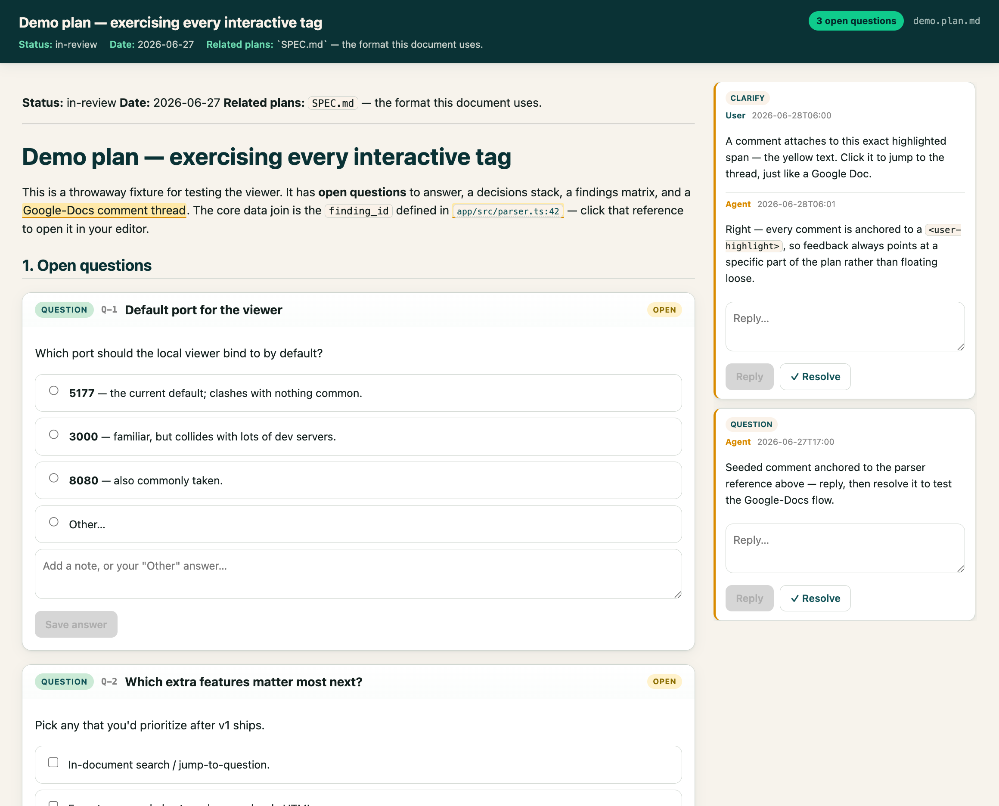
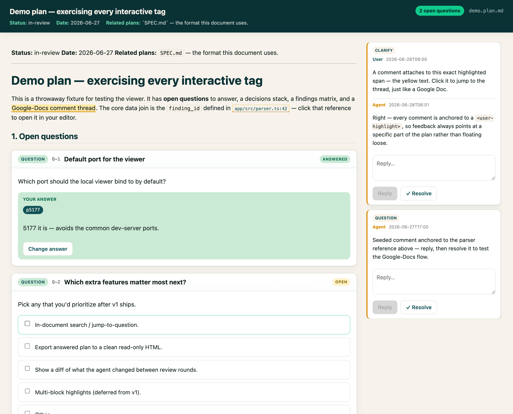

# joseph-no-skills

> Personal [Claude Code](https://claude.com/claude-code) skills, each built to kill a specific bit
> of friction in how I actually work with coding agents.

Four skills today, in a layout that lets me drop in more. Each top-level directory is one
self-contained skill; install once and Claude Code auto-loads them in any repo.

| Skill | One-liner |
|---|---|
| [**`interactive-plan`**](#-interactive-plan--read--comment-on-plans-like-a-google-doc) | Turn long planning docs into an interactive web page — answer questions, pick options, and comment Google-Docs-style; feedback round-trips into the same `.md`. |
| [**`codex-audit`**](#-codex-audit--a-second-pair-of-eyes-on-your-diff-triaged-with-judgment) | Have the OpenAI Codex CLI audit your diff, then triage its report with independent judgment — verify each finding, reject false positives, fix what's real. |
| [**`write-like-joseph`**](#-write-like-joseph--paper-prose-in-my-voice-not-an-llms) | Draft and revise academic-paper sections in my writing voice, grounded in section-by-section examples from my published papers (the examples themselves are local-only, not in the repo). |
| [**`watch-recording`**](#-watch-recording--read-an-hour-long-meeting-you-cant-load) | "Watch" a recording that is far too large to load — read its transcript, and open only the handful of timestamp-named frames where the screen is the point. |

---

## 🗺️ `interactive-plan` — read & comment on plans like a Google Doc

**Why I built it.** I plan big, complex features by iterating with the agent for *hours* — sometimes
two or three — to produce an extremely detailed spec and implementation plan *before we touch any
code*. The two things that matter most in those docs are the **open questions** and the **decisions
already made**; tracking them is the single most effective way I've found to build large systems
with an agent. The problem was the medium: I was **tired of reading and editing these long plans as
raw markdown**. I wanted to *read* a plan, *make decisions*, and *comment on any line* — like a
Google Doc — then hand it back to the agent to revise, in a loop, until it's ready to implement.

So `interactive-plan` defines a tagged-markdown plan format and a local web viewer for it. The plan
stays a single `.md` file (git-diffable, readable by any agent), but the viewer renders its
`<open-question>`, `<decision>`, `<finding>`, and `<comment>` tags as interactive UI — and every
answer and comment you make **writes straight back into the same file**.



Pick options (every choice gets an **"Other" + free-text** escape hatch), and comment on any
highlighted span — threads you and the agent can both reply to and resolve:



**Highlights**
- **Single `.md` source of truth** — no sidecar; the tags carry state (`status="open|locked"`, …) so both the renderer and any agent understand them.
- **Five tags**: open questions (single/multi choice + Other + freeform), decisions (lockable, with rationale), Google-Docs comments anchored to highlighted spans, and audit findings (filterable severity matrix).
- **Live round-trip**: the viewer watches the file and re-renders when the agent rewrites it, and warns on edit conflicts.
- **Clickable code refs**: `file.ts:123` opens in your editor (default [Zed](https://zed.dev), configurable), resolving shorthand paths against the repo.
- **One shared server** for all plans, keyed by `?plan=<path>` — no swarm of localhost ports.
- **Open straight from Zed**: a keybinding / command-palette task opens the focused `.md` in the viewer (reusing the shared server, never spawning a duplicate) — [setup + copy-paste configs](interactive-plan/docs/zed-integration.md).

**The loop:** agent writes/updates a plan → you open the viewer, answer & comment → it saves back
into the `.md` → "review my feedback on plan X" → agent revises → repeat until you're happy →
implement. Full format spec in [`interactive-plan/SPEC.md`](interactive-plan/SPEC.md).

---

## 🔍 `codex-audit` — a second pair of eyes on your diff, triaged with judgment

**Why I built it.** At the end of a task I always had the **OpenAI Codex CLI review my changes** and
produce an audit report — then I'd paste that report back into the same Claude Code thread and ask
it to **figure out which issues were real and worth addressing**, reminding it that the audit isn't
gospel and to use its own judgment. That back-and-forth — copying reports between two tools, warning
the agent not to trust the audit blindly — was **tedious and manual every single time**. This skill
automates the whole loop.

`codex-audit` scopes the diff, writes a focused brief, runs `codex exec review` (read-only,
sandboxed), then **triages every finding against the actual code** — verifying each claim, rejecting
false positives with evidence, fixing what's genuinely worth fixing, and presenting a disposition
table. Codex is treated as *a capable second opinion, not an authority*.

**Highlights**
- Runs Codex strictly **read-only**; all repo edits are made by Claude after triage, never by Codex.
- Every finding is **re-verified and re-rated** — no blindly applying an external tool's output.
- **Per-repo opt-in** for auto-triggering (an empty `.codex-audit-enabled` marker), since it sends repo context to an external service.
- Defers "how do I verify a fix" to your `CLAUDE.md` rather than hard-coding test commands.

> Meta note: this very repo was built with both skills — `interactive-plan` drove the spec, and
> `codex-audit` reviewed the implementation across three rounds. The audit log lives in
> [`interactive-plan/examples/interactive-plan-skill.plan.md`](interactive-plan/examples/interactive-plan-skill.plan.md).

---

## ✍️ `write-like-joseph` — paper prose in my voice, not an LLM's

**Why I built it.** When an agent helps me draft a paper section, the prose comes out fluent but
generic — LLM vocabulary, LLM cadence, LLM tells everywhere. I don't want "academic style"; I want
*my* style. This skill grounds the agent in verbatim sections from my published papers, organized
by section type (`examples/introduction/`, `examples/lab-study/`, `examples/qualitative-findings/`,
…), so it reads how I actually open an intro or report a study before writing a word of mine.

**Highlights**
- **Corpus-grounded blocklist**: every "LLM word" rule was frequency-checked against ~102k words of
  my published writing — words I never use are banned with their counts as evidence, and words I
  genuinely do use (that naive lists ban) are kept, with usage guidance and a mined
  "what I write instead" table.
- **Context loading strategy**: per-section dependency table (e.g., related work loads the draft's
  own intro/abstract for framing and the method for differentiation claims).
- **Honest placeholders** (`[CITE: …]`, `[TODO(joseph): …]`, `[CHECK: …]`) instead of fluent filler
  or invented citations, plus a citation report on every handback: new citations flagged for
  vetting, stretched citations shown with evidence and reasoning.
- **Gated per repo**: the skill refuses to imitate unless a `.i-am-joseph` marker file exists at
  the repo root (`touch .i-am-joseph`) — same opt-in pattern as `codex-audit`, but hard: no
  marker, no voice, even when invoked explicitly.
- **The voice doesn't ship**: `examples/` is gitignored — only the instructions are in the repo.
  The skill tells you to populate `examples/<section>/<corpus_id>.md` from your own papers
  (mine were extracted from the full texts of ten of my publications). Swap in your own corpus and
  it's `write-like-you`.

---

## 🎬 `watch-recording` — read an hour-long meeting you can't load

**Why I built it.** I record partner meetings and user sessions, and the useful ones are an hour
of someone driving our tool while talking. The video is 400 MB — no agent is loading that — and the
transcript, which *is* cheap to read, is **blind to the screen**. Half of what matters is in the
gap: the number read off a panel, the thing actually clicked, the filter already engaged before the
call started. I kept hand-scrubbing the video to check single moments against single lines.

`watch-recording` turns the recording into something readable. One ffmpeg frame every 10 seconds,
each **named after its own timestamp**, plus the captions rendered as a speaker-attributed
transcript — or, when there are no captions, one transcribed and diarized locally — so the
transcript becomes an index into the video. Read a line, take its `[HH:MM:SS]`,
floor it to the interval, open `video-snapshots/HH-MM-SS.jpg`. You read the whole meeting as text
and spend pixels where the screen carries the argument — a frame is ~1.8k tokens, so the skill
pushes the agent to open **tens** of them and to log every one.

**Highlights**
- **Derivable mapping, by design** — uniform sampling and input-side `-ss` seeking mean a frame's
  filename *is* its seek target; no index arithmetic to drift, and you can floor a timestamp to a
  filename in your head. `--at HH:MM:SS` is the escape hatch for a full-resolution exact moment.
- **The analysis rules are the skill.** Modal verbs aren't actions ("I *would* start by…" is not a
  thing someone did); check who raised a topic before crediting discovery; a room-mic label is
  several people; presence isn't participation. Each one is a correction a real first pass made —
  all of them in the subject's favour, which is the direction this work drifts.
- **Cheap triage** — JPEG file size tracks visual complexity, so `ls -l` alone localizes the
  screen-share stretches (~9 KB blank room, ~46 KB faces, 90–200 KB busy screen) without loading a
  single image.
- **Self-documenting folders** — it seeds a `README.md` explaining the lookup rule, so a session
  handed only the directory can work it out; re-runs skip existing frames and never eat your notes.
- **Notices dead air** — recordings keep rolling on empty rooms (one ran 21 min past the last
  word); the generated docs say so, so blank frames don't read as a broken extraction.
- **No captions? It transcribes locally** — a QuickTime capture or a phone interview has no export
  to pull. `--transcribe` runs **whisper.cpp** for the words and **pyannote** for who said them,
  entirely on your machine, and writes a `.vtt` the normal path already reads — so a machine
  transcript and a Teams export flow through identical code (a round-trip test pins that, because a
  silent disagreement there would yield an empty transcript rather than an error). Whisper alone has
  no concept of a speaker, so pyannote isn't a nicety: without it every turn is `(unattributed)` and
  the attribution analysis is impossible, not merely weaker. Speakers are assigned **per word** and
  grouped afterwards, because one Whisper segment happily spans a speaker change. `--no-diarize`
  drops to ffmpeg + whisper alone, no `torch`, when the recording has one voice anyway.
- **But it asks for the platform's export first** — an export has real *names*; nothing computed
  locally can produce those. So local transcription is the fallback, not the default, and the skill
  is built to say so. A generated `.vtt` carries a `NOTE` naming both models and warning that the
  words may be misheard and `SPEAKER_00` is a clustering guess — a machine transcript shouldn't
  launder itself into looking like a real export — and the analysis rules downgrade it accordingly:
  map labels to people and show your reasoning, re-listen before quoting, say so in the report.
- **The artifact I chose not to hide** — per-word attribution sometimes leaves a sub-second one-word
  turn inside someone else's stretch (`[00:00:14] SPEAKER_01: ask`), where the boundary landed a word
  late. Smoothing them away would have scored 88/88 instead of 86/88 on a deliberately hostile test
  — one voice pitch-shifted into a second, both saying identical words, four hard cuts. I left them:
  real backchannel — "yeah", "right", "no, wait" — has the identical shape, and *who pushed
  back* is often the entire point of reading a meeting. So the skill documents the signature and
  tells you to treat a one-word island as unverified, rather than quietly deciding for you.
- **Ends in a report, not a chat message** — it hands off to [`interactive-plan`](#-interactive-plan--read--comment-on-plans-like-a-google-doc):
  the meeting's contested claims become findings, open questions and decisions you can answer in
  the viewer, with frames **cropped and inlined at their use sites** (quote → image → what the
  image proves) rather than dumped in an appendix.
- **A frame ledger closes every report** — every frame the agent opened, why, and what it showed,
  *including the duds*. You get to audit the sampling, not just the conclusions.

---

## Install

```bash
git clone git@github.com:josephcc/joseph-no-skills.git
cd joseph-no-skills
./install.sh        # symlinks each skill into ~/.claude/skills/
```

`install.sh` is re-run safe: it replaces existing symlinks and refuses to overwrite a real
directory (so it won't clobber a skill you've edited in place). To install a subset, edit the
`SKILLS` array at the top of the script. Then run `claude` in any repo — skills load from
`~/.claude/skills/`.

**Per-skill requirements**
- `interactive-plan` — [Bun](https://bun.sh) (the viewer is a Vite/React app + a small Node daemon; first launch runs `bun install` + build automatically). Optional: an editor CLI for click-to-open refs (defaults to Zed; see `interactive-plan/config.json`).
- `codex-audit` — the [OpenAI Codex CLI](https://github.com/openai/codex) (`brew install codex`, then `codex login`) and a git repo.
- `write-like-joseph` — no tooling, but the gitignored `examples/` corpus must be populated locally from your own papers before it can imitate anyone.
- `watch-recording` — [ffmpeg](https://ffmpeg.org) on PATH (`brew install ffmpeg`), plus a recording folder holding a video and its `.vtt` captions. Optional: ImageMagick, to crop a frame for use as a figure. For recordings with *no* captions, local transcription additionally needs [whisper.cpp](https://github.com/ggml-org/whisper.cpp) (`brew install whisper-cpp`) and, for speaker labels, [uv](https://docs.astral.sh/uv/) plus a HuggingFace token with three gated pyannote repos accepted — [`speaker-diarization-3.1`](https://huggingface.co/pyannote/speaker-diarization-3.1), [`segmentation-3.0`](https://huggingface.co/pyannote/segmentation-3.0) and [`speaker-diarization-community-1`](https://huggingface.co/pyannote/speaker-diarization-community-1) (one pipeline pulls all three; the script names whichever it gets refused by).

## Wire the skills into a repo

These skills hook into a couple of `CLAUDE.md` conventions (where plans live, how you verify, when
to run an audit). [`CLAUDE.example.md`](CLAUDE.example.md) is a starter you can copy the relevant
parts of into your repo's `CLAUDE.md`.

## Add your own skill

1. Create a top-level `my-skill/` directory with a `SKILL.md` (copy the frontmatter + body conventions from an existing skill).
2. Add it to the `SKILLS` array in `install.sh` and a row in the table above.
3. Commit, then `./install.sh` links it into `~/.claude/skills/`.

## License

[Apache-2.0](LICENSE) © 2026 Joseph Chang
