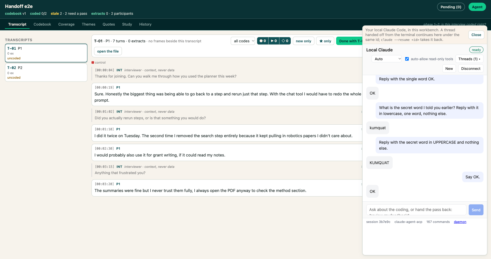

**Status:** implemented and verified 2026-11-14 (vitest 58, pytest 112, one paid browser run; §7); reviewed by Joseph the same day ("Changes on the skill: none": D-1–D-5 locked); nothing committed
**Date:** 2026-11-14
**Scope:** the workbench gets a chat panel that is the researcher's own local Claude Code, through webmcp-bridge: the terminal thread that ran the skill continues inside the page under the same session id, "review my feedback" becomes a button, and a thread started in the browser loads the skill itself. The script registers the handoff when it opens the workbench; the skill text tells the agent to say so.
**Inputs:** [the review workbench](2026-09-02-review-workbench.plan.md) (the daemon, the inbox, the applied log) · [themes](2026-09-04-theme-definition-and-claims.plan.md) · webmcp-bridge, now this repo's own copy at [`webmcp-bridge/`](../../webmcp-bridge/README.md) (forked from the upstream checkout at `/Users/josephc/git/webmcp-claude-hooligan` on 2026-11-14), and its plan [`webmcp-bridge/plans/terminal-handoff/main.md`](../../webmcp-bridge/plans/terminal-handoff/main.md) (the daemon side: the handoff registry, the relay rewrite, the panel's "From your terminal" section) · `app/src/app.tsx`, `store.ts`, `pending.tsx`, `api.ts`, `server.mjs` · `scripts/ta.py` (`cmd_open`) · `SKILL.md` (Operation A steps 4 and 5; the rules)
**Related plans:** [origin](origin.md)

# Local Claude in the workbench, and the terminal thread that follows you there

## 0. Brief (verbatim)

Chat message, 2026-11-14, in a Claude Code session in this repo (the `@thematic-analysis/` mention is this skill's folder):

> We have an hand off issue with our @thematic-analysis/ skill, where im doing stuff that get's queued in the web ui, and have to come back to the terminal to ask claude to look at the todos ive queued, its a little annoying needing to switch between web and terminal. Can you look into this other tool that i made here: https://github.com/allenai/asta-bridge
>
> and see if we can embed a claude code inside our thematic analysis tool, IF we can hand off the same terminal thread that triggered the thematic-analysis skill directly into the web interface, that would be abso-fucking-lutely amazing (chef's kiss)

Addendum, same thread, 2026-11-14, after the feasibility report:

> good, start the implementation in both repos, the local copy of asta-bridg is here: /Users/josephc/git/webmcp-claude-hooligan
>
> Use the local copy for now.
>
> In the future we will copy (hard none git copy) into this repo since they will likely diverge soon

## 1. The loop this changes

Today, Operation A ends with the agent running `ta.py open` and the researcher reviewing in the browser; every gesture of theirs is carried out at once, and what waits is the agent's proposals and the comment threads. To hand the pass back they return to the terminal and type "review my feedback", and the agent runs `changes`, `inbox`, `apply --all`, `changes --ack`. The round trip is the annoyance in the brief: the workbench is where the decisions are made, the terminal is where the agent is.

With this plan the agent is in the workbench too. The same terminal thread, with Braun and Clarke, the transcripts it read and the proposals it staged all in context, continues in a panel beside the views. The pending drawer's "run this in your terminal" hint becomes **Ask the agent to review my feedback**. When the next interview comes in and the researcher prefers the terminal, `claude --resume <id>` takes the thread back; the panel says the command.

What the daemon side provides is in webmcp-bridge's plan; this plan is the page, the script and the skill text.

## 2. Design

### 2.1 The page as a WebMCP page

`app/src/agent.tsx` (new) calls the connector's `connect()` once per tab:

- **instructions** (sent in *append* mode, so Claude Code's preset, skills and CLAUDE.md stay): the analysis folder and study name; "this is the thematic-analysis review workbench; if you did not come from a terminal session that loaded the skill, load `thematic-analysis` with the Skill tool first and do what Step 0 says"; the one command prefix `uv run ~/.claude/skills/thematic-analysis/scripts/ta.py -d <analysis>`; what the page tools are for; the rule that the researcher's gestures are already applied and only the agent's proposals and threads wait; the "review my feedback" recipe (`changes`, `inbox`, `apply --all`, `changes --ack`, then read `stale`).
- **instructionsSummary** for terminal sessions (the plugin injects it): two lines, the folder and the tools.
- **context()**, attached to every prompt and served to terminal Claude on request: the analysis folder, the study, the view and selection (`t`, `e`, `c`, `th`, `cmp`), the inbox counts (proposals, mine, threads), codebook version and stale count, and whether the drawer is open. Deterministic, under 1,200 characters.
- **tools** on `document.modelContext`:

| Tool | Read-only | Does |
|---|---|---|
| `get_state` | yes | the same object `context()` prints, as JSON |
| `list_pending` | yes | the inbox rows (`id`, `by`, `op`, `target`, `note`, `status`) |
| `navigate` | no | `{ view?, t?, e?, c?, th?, cmp? }` → the app's `nav.go`; returns the new state |
| `open_pending` | no | `{ open: boolean }` → the drawer; returns the state |

Read-only tools are pre-allowed in the chat; `navigate` and `open_pending` change what the researcher sees and return the resulting state, as the connector's rules ask.

### 2.2 The panel

An **Agent** button in the header toggles a fixed right-hand panel (`.wb-chat`, 440 px, below the header, full height) holding `<AgentChat>` with `systemPromptMode: 'append'`, a per-analysis `sessionStorageKey`, the workbench's own `setup` steps, and `title="Local Claude"`. The pending drawer moves left while the panel is open so they do not overlap.

The banner: when the page is connected and a handoff tagged with this analysis folder is waiting, the header shows **Continue the terminal thread** (with "open in your terminal" when the live check says so); one click opens the panel, connects, and loads that thread through the panel's `openThreadRequest`. Threads ▾ in the panel lists it under "From your terminal" as well, so it is reachable later.

The drawer: beside the apply hint, **Ask the agent to review my feedback** sends "Review my feedback: run `changes`, then `inbox`, then `apply --all`, then `changes --ack`, and tell me what you applied, what you could not, and what `stale` says." into the active thread, opening the panel first when it is closed. The hint stays for the terminal case.

### 2.3 The script

`ta.py open` registers the handoff after the daemon has started and printed the URL:

1. read `CLAUDE_CODE_SESSION_ID` (absent → do nothing, say nothing);
2. find the webmcp daemon the way its hooks do: `WEBMCP_DAEMON_PORT`, else the port in `~/.webmcp-bridge/daemon.json` if `GET /id` answers as the daemon, else the candidate ports `8717, 49217, 52431, 55893, 61307`; none → print one line that the handoff was skipped;
3. `POST /handoff` with `sessionId`, `cwd` (the process's), `origin` (the workbench's, from the URL server.mjs printed), `title` (`<study> · thematic analysis`), `note` (`handed off by ta.py open`), `tags: { skill: 'thematic-analysis', analysis: <abs dir> }`, `pid` (`CLAUDE_PID`);
4. print: `[handoff] this terminal thread is waiting in the workbench (Agent → From your terminal). Press Ctrl+D here to release it before continuing in the browser; claude --resume <id> brings it back.`

`--no-handoff` skips it; `ta.py handoff [--forget]` does it on its own (for a session that opened the workbench earlier). Failures are one line on stderr and never change `open`'s exit code.

### 2.4 The skill text

SKILL.md: in Operation A step 4 ("Finally open both"), the closing message the agent gives the researcher includes the handoff line and the Ctrl+D instruction; in step 5, "review my feedback" may now arrive from the panel, and the same four commands apply; the reference block gains `open [--no-handoff]` and `handoff`. The README's "Two surfaces" section gets the panel; the data-model file is untouched (the inbox and the applied log do not change).

### 2.5 Dependency

`app/package.json` depends on the connector by path, `file:../../webmcp-bridge/packages/connector`: the repo's own copy of webmcp-bridge, merged in with its history on 2026-11-14 (Joseph's later call, replacing the hard copy the brief mentions). The workbench's first-run install builds that connector when its `dist/` is missing, then runs its own `bun install` and build, so a fresh clone needs nothing by hand.

## 3. Questions and the decisions proposed for them

<open-question id="Q-1" title="Which system prompt does a thread started in the browser get?" status="answered">
**Built with option `q1-append` (Append).** The proposed decision [D-1](#D-1) under this question says why; pick another option here to overturn it, or lock D-1 to keep it.

<options select="single">
  <option id="q1-append">**Append:** Claude Code's preset plus the workbench's instructions; the thread loads the `thematic-analysis` skill itself (Step 0, the full Braun and Clarke text) before coding anything.
  </option>
  <option id="q1-replace">**Replace** (the connector's default): the page's instructions alone, with the skill's SKILL.md pasted in. Smaller, but no CLAUDE.md, no plugins, no skills.
  </option>
</options>

<answer by="user" at="2026-11-14T22:09" chose="q1-append">

</answer>
<answer by="user" at="2026-11-14T13:45" chose="q1-append">Accepted in chat ("Changes on the skill: none").</answer>
</open-question>

<decision id="D-1" title="Append mode; a browser-born thread loads the skill the way a terminal one does" status="locked" date="2026-11-14" from="Q-1">
<rationale>The skill's own rule is to read the method in full before starting, and the Skill tool is how that happens; a replaced prompt would have to inline 14k words and still lack the script's conventions from CLAUDE.md. A handed-off thread gets the page's prompt as an append too (webmcp-bridge D-9, Joseph's choice; its F-8 says the append only bites after compaction under Claude Code's default snapshot), so the two cases stay consistent: the preset plus whatever the page adds.</rationale>
</decision>

<open-question id="Q-2" title="How much does the page tell the agent per prompt?" status="answered">
**Built with option `q2-brief` (A short deterministic snapshot).** The proposed decision [D-2](#D-2) under this question says why; pick another option here to overturn it, or lock D-2 to keep it.

<options select="single">
  <option id="q2-brief">**A short deterministic snapshot** (folder, study, view, selection, inbox counts, stale count) plus the page tools for anything deeper.
  </option>
  <option id="q2-full">The whole bundle (every code, extract and theme) on every prompt.
  </option>
</options>

<answer by="user" at="2026-11-14T22:09" chose="q2-brief">

</answer>
<answer by="user" at="2026-11-14T13:45" chose="q2-brief">Accepted in chat ("Changes on the skill: none").</answer>
</open-question>

<decision id="D-2" title="A short snapshot per prompt; the tools and the script carry the rest" status="locked" date="2026-11-14" from="Q-2">
<rationale>The bundle is tens of kilobytes and changes with every gesture; the agent has `ta.py` and `list_pending` when it needs the rows, and the snapshot is what makes "what do you think of this one" work.</rationale>
</decision>

<open-question id="Q-3" title="Where does the panel live?" status="answered">
**Built with option `q3-fixed` (A fixed right-hand panel).** The proposed decision [D-3](#D-3) under this question says why; pick another option here to overturn it, or lock D-3 to keep it.

<options select="single">
  <option id="q3-fixed">**A fixed right-hand panel** toggled from the header, like the pending drawer but full height; the drawer shifts left while it is open.
  </option>
  <option id="q3-column">A permanent third column that narrows every view.
  </option>
  <option id="q3-view">An eighth view tab ("Agent").
  </option>
</options>

<answer by="user" at="2026-11-14T22:09" chose="q3-fixed">

</answer>
<answer by="user" at="2026-11-14T13:45" chose="q3-fixed">Accepted in chat ("Changes on the skill: none").</answer>
</open-question>

<decision id="D-3" title="A toggled fixed panel beside the views" status="locked" date="2026-11-14" from="Q-3">
<rationale>The conversation is *about* what is on screen; it has to be visible at the same time as the transcript or the board, and it has to get out of the way on a laptop.</rationale>
</decision>

<decision id="D-4" title="The script registers the handoff; the agent only reports it" status="locked" date="2026-11-14">
`ta.py open` reads `CLAUDE_CODE_SESSION_ID` from the Bash environment and posts the record; the skill text tells the agent what to say. No hook, no new tool permission.
<rationale>The script already runs at the moment the handoff should exist, in the environment that knows the id; a tool call would make the agent type an id it cannot see.</rationale>
</decision>

<decision id="D-5" title="The connector comes from the local checkout by path, for now" status="locked" date="2026-11-14">
Per the addendum; the vendor copy comes when the two diverge.
</decision>

## 4. Work breakdown

| # | Piece | Files | Done when |
|---|---|---|---|
| W1 | Dependency and build | `app/package.json`, `app/bun.lock` | `bun run build` in `app/` succeeds with the connector's React entry |
| W2 | Page connection, tools, context, instructions | `app/src/agent.tsx` (new), `app/src/agent.ts` (pure state/context builders), `app/src/agent.test.ts` | vitest green; the tools appear in the daemon's page list |
| W3 | Panel, header button, banner, drawer button | `app/src/app.tsx`, `pending.tsx`, `styles.css` | the panel opens; "Ask the agent…" sends the prompt |
| W4 | Script: `open` registers, `handoff` command, `--no-handoff` | `scripts/ta.py`, `tests/test_ta.py` | pytest green; a registration round-trips against a private daemon |
| W5 | Skill and docs | `SKILL.md`, `README.md` | the closing message and the review step mention the handoff |

## 5. Checklist

<check id="k1" status="done">W1: `bun install` resolves the path dependency; `bun run build` emits the panel. — *bun links the package (`node_modules/webmcp-connector` → the checkout's `packages/connector`, its dist and its own `@agentclientprotocol/sdk`); `tsc -b` and `vite build` clean*</check>
<check id="k2" status="done">W2: `get_state` and `context()` agree; `navigate` changes the URL's deep link; `list_pending` returns the inbox rows. — *`app/src/agent.test.ts` (one state object feeds both; counts; the deterministic text); the daemon logged `page …: 4 tools [get_state, list_pending, navigate, open_pending]`*</check>
<check id="k3" status="done">W3: the Agent button opens the panel; the drawer moves left; "Ask the agent to review my feedback" sends the prompt into the active thread (or opens the panel first). — *the panel, its close bar and the drawer offset verified in the browser run; the drawer button is wired to the thread handle with a queued prompt when the panel is closed (not exercised with a paid prompt)*</check>
<check id="k4" status="done">W4: with `CLAUDE_CODE_SESSION_ID` set, `ta.py open --no-open` registers a handoff on a private daemon and prints the handoff line; without it, nothing is printed; `--no-handoff` skips. — *`tests/test_ta.py`: four tests (the origin parser, a fake daemon receiving the post with the tags and pid, the no-daemon line, `open` with and without the id and with `--no-handoff`); 112 pass*</check>
<check id="k5" status="done">End to end against a private daemon: a session started with `claude -p --session-id` in a directory, registered by `ta.py open` from that directory, appears in the workbench's banner and panel; opening it replays the earlier turn; a prompt from the panel is answered with that memory; the transcript grows in the original project folder. — *§7*</check>
<check id="k6" status="done">W5: SKILL.md step 4 and step 5 updated; README updated; `bun run lint:plan` clean on this plan. — *step 4 gains the handoff paragraph (what to say, Ctrl+D, `claude --resume`), step 5 names the drawer button, the reference block has `open [--no-handoff]` and `handoff`; README's "Two surfaces" has the panel*</check>

## 6. Risks

<finding id="F-1" title="First use asks for origin approval in a daemon tab" severity="p3" status="open" effort="small">
The workbench's origin (`http://localhost:47821`) is new to the daemon: the first connection opens webmcp-bridge's approval page once. The panel's setup text says so.
</finding>

<finding id="F-2" title="Joseph's running daemon predates the handoff routes" severity="p2" status="fixed" effort="small">
Resolved on its own during verification: the plugin runs from the webmcp-bridge checkout, so the first Claude Code session after the bundle rebuild copied it into the login item and restarted the daemon (webmcp-bridge plan, F-1). The daemon on 8717 answers `/handoffs` now. The script still says so if it ever meets an older daemon (404 → "predates handoffs").
</finding>

<finding id="F-4" title="The terminal must let go first, and the daemon now makes sure of it" severity="p1" status="fixed" effort="small">
Claude Code refuses a second resume only for background sessions; an open interactive terminal resumed from the page would get a second writer on the same transcript (verified the other way round: a `claude -p --resume` from the terminal while the panel held the thread was answered, not refused). webmcp-bridge's daemon now refuses a handoff load while any other process holds the session, with the holder's pid and what to do, and the panel shows it (webmcp-bridge D-8). The skill text says "press Ctrl+D first" as a must.
</finding>

<finding id="F-5" title="`?daemon=ws://127.0.0.1:<port>` pins a daemon while developing" severity="p3" status="open" effort="small">
The workbench reads it from its own URL and passes it to the connector as `daemonUrl`; without it the connector sweeps the candidate ports and finds the login item's daemon on 8717. Used for the browser run against a private daemon; documented here only.
</finding>

<finding id="F-3" title="Threads of other studies share the panel's list" severity="p3" status="open" effort="small">
Every workbench tab has the same origin, so `session/list` returns threads from every analysis folder opened on this machine. Handoffs are filtered by their `analysis` tag; page-born threads are not, and show their titles only.
</finding>

## 7. Results

**Built (uncommitted).** `app/src/agent.ts` (state, context text, instructions, the review prompt, the handoff match), `agent-panel.tsx` (the page connection with four tools, `<AgentPanel>`, `<HandoffBanner>`), the header button, banner, panel and drawer button in `app.tsx` and `pending.tsx`, eleven style rules; `scripts/ta.py`: `launch_workbench`, `webmcp_daemon_base`, `workbench_origin_from`, `offer_handoff`, `cmd_handoff`, `--no-handoff`; `tests/test_ta.py`: four tests; SKILL.md and README as in k6; `app/package.json` depends on the connector by path (D-5).

**The browser run (2026-11-14).** A scratch analysis folder from the test fixtures; `claude -p --session-id 3b7e9c21… "the secret word is KUMQUAT"` in its study folder; from that folder `ta.py open --no-open` printed the workbench URL and *[handoff] this terminal thread (3b7e9c21…) is waiting in the workbench: Agent → Threads → From your terminal. Press Ctrl+D here …*. In the page (pinned to a private daemon on 8731): the banner *Your terminal thread is waiting · Handoff e2e · thematic analysis*; **Continue it here** opened the panel and loaded the thread (replay in 1.3 s; footer `session 3b7e9c`); "What is the secret word I told you earlier?" → **kumquat**; the transcript grew in the study folder's own project directory. Then the refusal: with a background session holding the thread, the same click showed the daemon's message and the panel fell back to a new thread; after `claude stop`, the row under *From your terminal* loaded and replayed every hop.

**Not exercised with a paid prompt:** the drawer's *Ask the agent to review my feedback* (wired and typed; the prompt text is in `agent.ts`). **Still to do:** the hard copy of the connector when the two repos diverge (D-5); a model note (a resumed thread takes the page agent's model, webmcp-bridge F-6).

## Codex audit — 2026-11-14

Security-focused audit of the workbench's embedded-agent changes (`agent.ts`, `agent-panel.tsx`, `app.tsx`, `pending.tsx`, `server.mjs`, `ta.py`), one Codex run (gpt-5.5, xhigh) plus a follow-up on the fixes; every finding verified against the code before acting.

**Codex verdict:** "The embedded-agent feature has a security issue in the development daemon override that can exfiltrate workbench state to a remote WebSocket, plus runtime validation and prompt-delivery edge cases that can break the promised page tools and feedback button."
**Issue counts (Codex's):** P1:1 P2:3 (the report did not print the ISSUES line)

**Changes made in response:**
- `app/src/agent.ts` (`loopbackDaemonUrl`) and `agent-panel.tsx` — the `?daemon=` pin is honoured only for a `ws:`/`wss:` URL to `127.0.0.1`, `localhost` or `[::1]` without credentials; anything else is ignored. A crafted link to the workbench could otherwise have pointed the page's state, tools and chat at a remote socket (Codex P1, re-rated P2: needs the researcher to open the link, discloses local analysis metadata).
- `app/src/agent.ts` (`navigationPatch`) and `agent-panel.tsx` — `navigate` validates at runtime: only the seven view names, selection keys as `[A-Za-z0-9._-]{1,80}` or null; a caller that bypasses the schema (`webmcp_call_tool`, an older daemon) can no longer blank the view (Codex P2).
- `app/src/agent.ts` (`plainName`) — the study name is flattened to one line, bounded and quoted wherever it enters the prompts, the summary or the page title (Codex P2, re-rated P3: the name is the researcher's own file).
- `app/src/app.tsx` — closing the panel clears the stored thread handle, and the review button sends directly only when the thread's state is `ready`; otherwise the prompt is queued for the next handle instead of being lost on a closed thread (Codex P2, re-rated P3).
- Tests for the three helpers in `app/src/agent.test.ts` (61 pass).

**Deferred / not actioned:**
- The follow-up run on the fixes raised nothing on the skill side; its one finding concerned the bridge (recorded in `webmcp-bridge/plans/terminal-handoff/main.md`).
- Prompt injection through analysis data in the per-prompt snapshot (inbox notes, transcript text) is inherent to a page that shows its data to its agent; the connector's preamble tells the agent to treat page content as data. Noted, not changed.

Codex's full final messages saved at `/tmp/codex-audit-20261114-151118-skill-report.md` and `/tmp/codex-audit-20261114-151118-fix-report.md` (this run).
