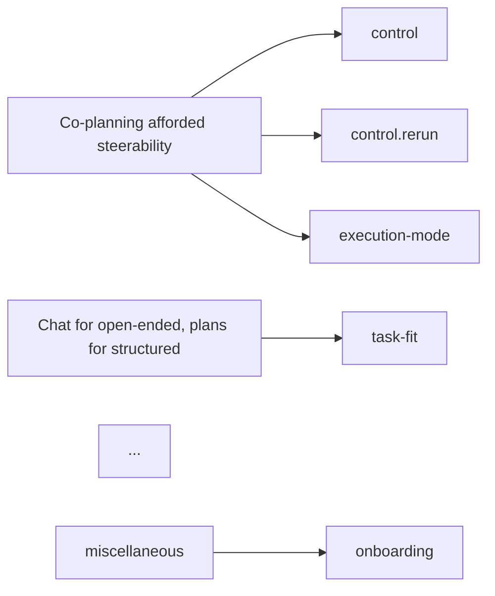

# Review documents: the three negotiation rounds

Every decision about codes, themes, and quotes is the researcher's. The agent proposes, shows
evidence, and asks; the user answers in the `interactive-plan` viewer; the agent applies the
answers to the data files and records them. This file gives the shape of each round's document.
Load `interactive-plan` for the full tag syntax; lint and launch with:

```bash
cd ~/.claude/skills/interactive-plan/app && bun run lint:plan <abs-path>.plan.md
node ~/.claude/skills/interactive-plan/app/server.mjs <abs-path>.plan.md
```

Documents live in `analysis/reviews/` and are named `YYYY-MM-DD-<round>-<n>.plan.md`
(`codebook-3`, `themes-1`, `quotes-1`). They are never deleted; together they are the audit
trail from a participant's sentence to a published theme.

Rules that hold across all three:

- **Every quote carries its extract id** (`E-0041`) and participant, and is pasted from the
  extract record, so `ta.py verify-quotes` passes on the document itself. Run it before
  launching. The line form the checker understands is
  `> **E-0041** P1 [00:14:22] [did]: "the words"` (the `[did]`/`[intent]` marker only when the
  kind is not `said`); consecutive quote lines may be stacked in one blockquote, and a trailing
  `*(note ...)*` in italics is ignored.
- **Every proposal is a question with real options**, plus a reason. The viewer adds "Other" and
  a freeform box automatically, so list only genuine alternatives.
- **Definitions are highlightable.** Wrap each code definition and theme essence in a
  `<user-highlight comment="...">` so the user can comment on the exact words; when they do,
  the comment thread becomes the record of why the definition changed.
- **Ids are stable across rounds.** A question about code `control` is `Q-C-control` in every
  round it appears; when answered, it becomes `<decision id="D-C-control" from="Q-C-control">`
  in the next document.
- **Counts come from `ta.py coverage`**, pasted, never typed.

---

## Round A′: the coded transcript (alongside every Round A)

`ta.py annotate T-07 -o reviews/annotated/T-07-P7.plan.md` writes it; nothing is authored by hand.
Each extract is a `<user-highlight>` on its exact span with a `<comment>` thread listing codes, kind,
context, and note; a codes table sits at the top. The user reviews the coding by reading the
interview and replying on spans. Reading their replies: a reply on `x-E-0042` is about that extract
(recode, re-trim with `drop` + `extract --from/--to`, change kind); a highlight they added themselves
on uncoded text is a request for an extract there; a reply on an interviewer turn is context, not a
coding change. Regenerate the file after applying, and never edit the generated file directly.

## Round A: codebook review (after each interview)

```markdown
**Status:** codebook round 3 · after T-07 (P7)
**Date:** 2026-09-01
**Scope:** 2 new candidate codes · 1 suspected duplicate · 2 definition edits · 6/7 transcripts coded

# Codebook review after P7

## What changed this pass
| | |
|---|---|
| transcript read | T-07, 214 turns, 61 min |
| extracts added | 23 (18 said · 3 did · 2 intent) |
| existing codes applied | control (5), control.rerun (2), trust (4), ... |
| new candidates | `verification-habit`, `scope-of-delegation` |
| coverage | see table at the end |

## New candidate codes

### `verification-habit` · Checking the agent's output against the source
<user-highlight comment="c-def-verification">**Definition.** Participant describes opening the
underlying document to check a summary or claim the agent produced, as a habit rather than a
reaction to a specific error. *Include:* "I always open the PDF anyway". *Exclude:* checking
triggered by a noticed contradiction (→ `trust.repair`).</user-highlight>

Evidence (3 participants so far):
> **E-0142** P7 [00:14:22]: "The summaries were fine but I never trust them fully, I always open the PDF anyway to check the method section."
> **E-0097** P4 [00:31:05]: "..."
> **E-0031** P2 [00:01:35]: "I only opened the PDF when the summary contradicted something I already knew."  *(borderline: reactive, not habitual, which is why the exclude clause exists)*

Why a new code and not `trust`: `trust` currently holds attitudes; this is a behaviour with a
different design implication (a verification affordance vs. a trust calibration one). Alternative
considered: make it `trust.verification` (child).

<open-question id="Q-C-verification-habit" title="Accept `verification-habit`?" status="open">
<options select="single">
  <option id="accept">Accept as a top-level code, definition as written.</option>
  <option id="accept-child">Accept as `trust.verification`, a child of `trust`.</option>
  <option id="accept-edit">Accept, but change the definition (comment on the highlighted text).</option>
  <option id="reject">Reject; recode these extracts under `trust`.</option>
</options>
</open-question>

<comment id="c-def-verification" status="open" kind="clarify">
  <note by="agent" at="2026-09-01T10:00">Highlight any words in the definition to change; the include/exclude line is the part most likely to need your judgement.</note>
</comment>

## Suspected duplicates
<finding id="F-dup-3" title="`agent-steering` and `control` share 6 of 8 extracts" severity="p2" status="open" effort="small">
`ta.py dupes` reports 0.75 extract overlap and a name overlap. Proposed: merge `agent-steering`
into `control` and add its include clause to `control`. Affected extracts: E-0012, E-0019, ...
</finding>
<open-question id="Q-merge-agent-steering" title="Merge `agent-steering` into `control`?" status="open">
<options select="single">
  <option id="merge">Merge (recodes 8 extracts; codebook v4).</option>
  <option id="keep">Keep both; I'll sharpen the definitions (comment on them).</option>
  <option id="child">Make `agent-steering` a child of `control`.</option>
</options>
</open-question>

## Definition edits proposed
(one per code, with the current text highlighted, the proposed text, and the extract that forced the change)

## Coverage after this pass
(paste `ta.py coverage` tables: codes × participants, participants with gaps, transcripts and their codebook version)

## Memos from this pass
(2–5 bullets: hunches, tensions, things to watch for in the next interview)
```

After the user answers: apply each answer (`bump`, `merge-code`, edits to `codebook.yaml`,
`recode`), convert each answered question to a `<decision>` in the *next* round's document,
reply to comments, and record the round in the codebook changelog. Then run `stale`: any code
added or redefined after a transcript was coded means that transcript needs a pass for that
code.

---

## Round B: theme review (after the full coding pass)

```markdown
**Status:** themes round 1 · codebook v6 frozen · 12/12 transcripts coded
**Date:** 2026-09-14
**Scope:** 5 candidate themes (2 with sub-themes) · 1 miscellaneous pile · 3 codes unplaced

# Candidate themes

## Thematic map


## TH1 · Co-planning afforded steerability  (RQ1)  · 11/12 participants · 47 extracts
<user-highlight comment="c-ess-TH1">**Essence.** Participants steered the agent by composing,
editing, and rerunning plan steps, and read this as control they lacked in chat. The value was
in intervening mid-process, not in better output.</user-highlight>

**Codes gathered:** `control` (11/12), `control.rerun` (7/12), `execution-mode` (9/12).

**The story.** (3–6 sentences of analytic narrative: what the pattern is, what it means, how it
answers RQ1, how it relates to the design decision it speaks to.)

**Representative extracts**
> **E-0041** P1 [00:14:22]: "..."
> **E-0203** P6 [00:22:10]: "..."
> **E-0310** P11 [00:05:48] [did]: "..."  *(reran the search step after restricting venues, then said this)*

**Tension.** P8 and P9 preferred continuous execution and described stepwise control as
overhead: **E-0288** P8: "..." The theme holds if it is about *having* the option, not using it.

**Level-2 check.** Re-read all 12 transcripts for this theme: 2 new extracts added (E-0401,
E-0402), none contradicting.

<open-question id="Q-TH1" title="TH1: include, and how?" status="open">
<options select="single">
  <option id="headline">Headline theme (its own subsection).</option>
  <option id="secondary">Secondary (a paragraph inside another theme's section).</option>
  <option id="merge">Merge with TH3 (they share `execution-mode`).</option>
  <option id="split">Split: co-planning vs co-execution as two themes.</option>
  <option id="drop">Drop from the paper.</option>
</options>
</open-question>
<open-question id="Q-TH1-name" title="TH1: name" status="open">
Alternatives: "Interactive plans as a steering surface" · "Stepwise control over the agent".
</open-question>

(repeat per theme)

## Unplaced codes
`onboarding` (4/12), `pricing` (1/12), `humour` (2/12): candidates for a miscellaneous note,
a limitations sentence, or dropping. 

<open-question id="Q-unplaced" title="Unplaced codes" status="open">
<options select="multi"> ... </options>
</open-question>

## The overall story
One paragraph: what the themes together say about the research question, and the order in which
they should be told. This is the thing most worth the user's edits.
```

Before launching: `ta.py collate TH1` for every theme and actually read it (level 1); re-read
every transcript with the map in hand (level 2) and code what was missed; run `validate`,
`verify`, `verify-quotes` on the document.

---

## Round C: quote selection (after themes are settled)

```markdown
**Status:** quotes round 1 · 4 themes in paper
**Date:** 2026-09-20

# Quotes for the paper

Selection criteria used: vivid, self-contained, exemplifies the theme's *claim* (not just its
topic), spreads attribution across participants, and, where possible, a `did` extract beside
a `said` one. Alternatives listed so you can overrule.

## TH1 · Co-planning afforded steerability (headline)
Need: 2 inline + 1 block. Participants not yet quoted anywhere in the draft: P2, P5, P10.

<open-question id="Q-quotes-TH1" title="TH1 quotes" status="open">
<options select="multi">
  <option id="E-0041">**E-0041** P1 [00:14:22] (23 words, inline): "..." — the cleanest statement of the chat contrast.</option>
  <option id="E-0203">**E-0203** P6 [00:22:10] (61 words, block): "..." — shows the mechanism step by step.</option>
  <option id="E-0310">**E-0310** P11 [00:05:48] (did): reran search after restricting venues: "..." — an action, not an opinion.</option>
  <option id="E-0177">**E-0177** P5 [00:40:02] (19 words, inline): "..." — weaker, but P5 is otherwise unquoted.</option>
</options>
</open-question>

Tension to keep: **E-0288** P8 (see themes round). 
<open-question id="Q-tension-TH1" title="Keep the P8 counter-example in the paper?" status="open">...</open-question>

(repeat per theme)

## Attribution spread
| participant | quotes selected | themes |
|---|---|---|
```

After the user answers: write the chosen ids into `themes.yaml` `selected_extracts` (in the
order they should appear) and `tensions`; run `ta.py report`; hand `reports/quote-bank.md` and
`reports/themes.md` to the writing step.
