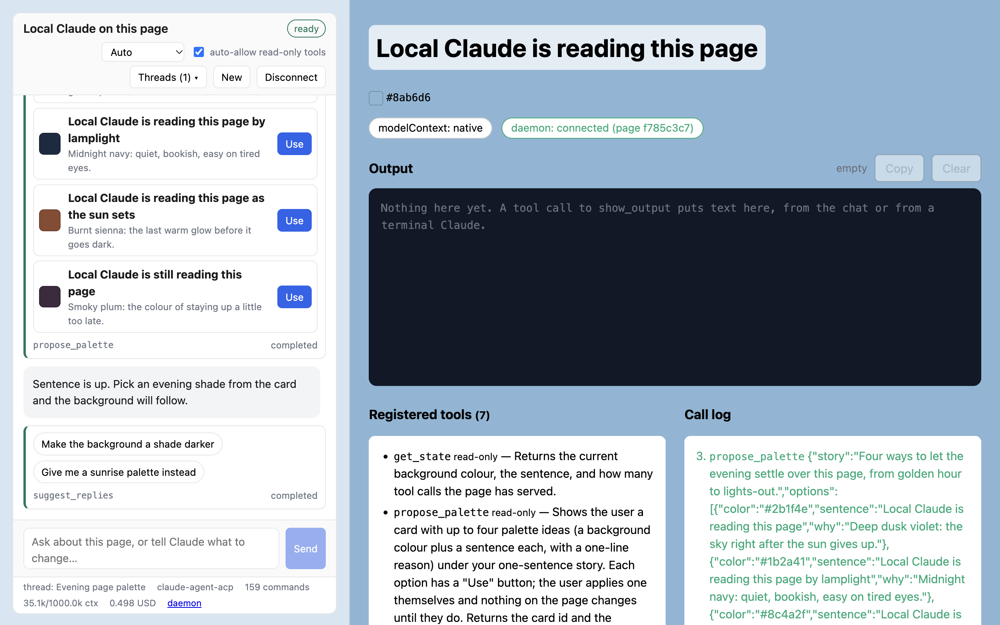
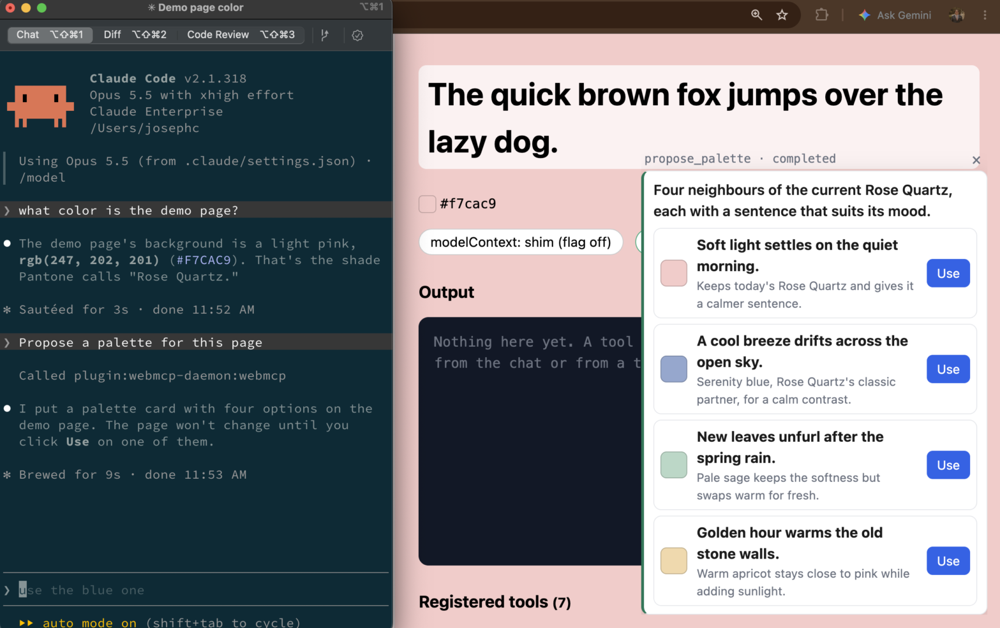
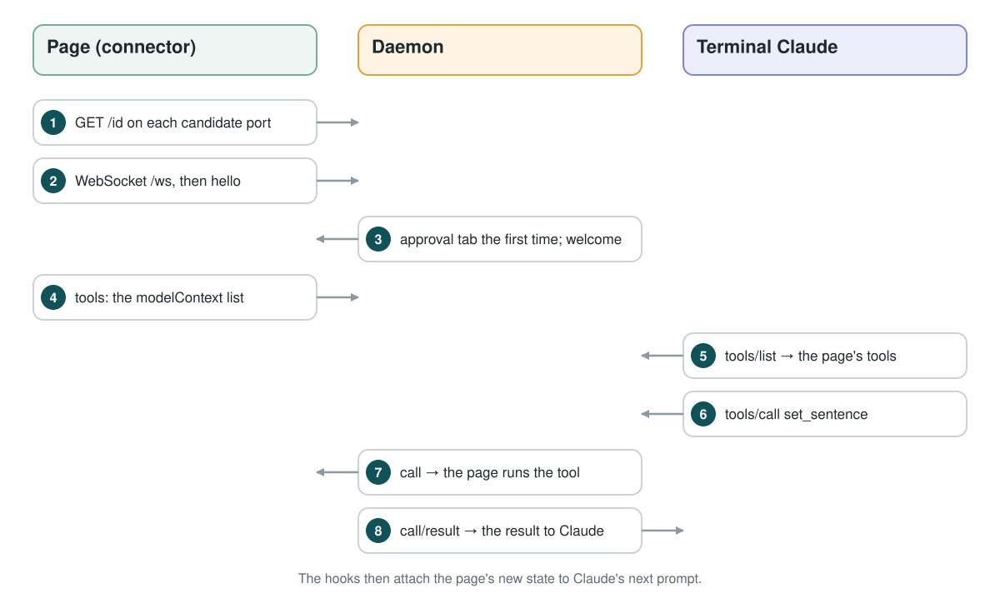
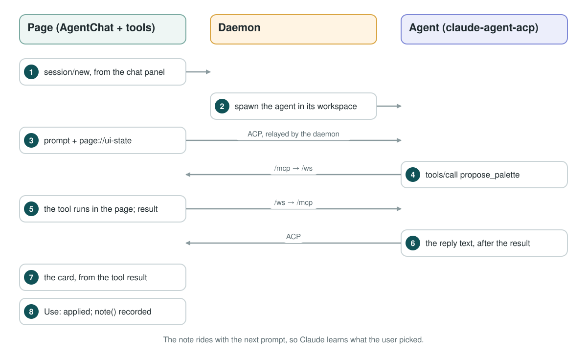
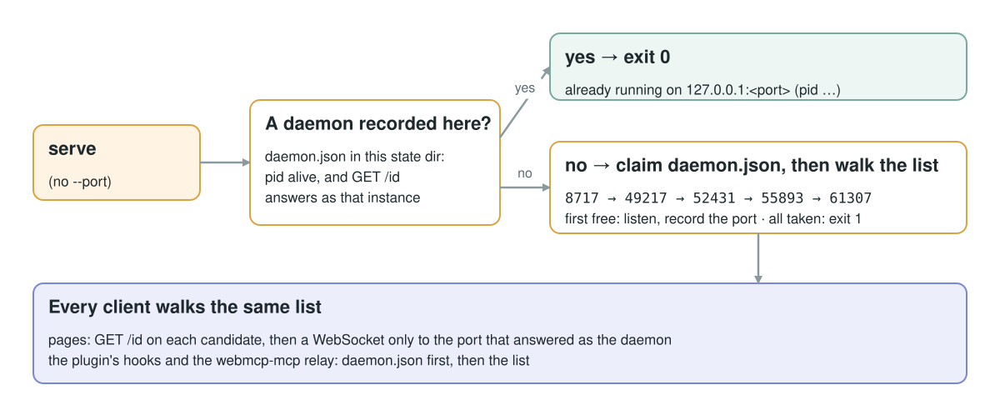

# webmcp-bridge — your local Claude Code, inside the web page you are looking at

A web page describes itself to [WebMCP](https://webmachinelearning.github.io/webmcp/) (tools on
`document.modelContext`, plus instructions and a snapshot of what the user sees). A small daemon on your
machine mirrors that to **your own Claude Code**, in two directions: a chat panel embedded in the page talks
to Claude through the [Agent Client Protocol](https://agentclientprotocol.com), and a terminal Claude Code
session sees and operates the same page through MCP. Nothing leaves your machine except what Claude Code
itself sends to Anthropic; the page never holds a key.


Three things ship from this repo:

| Deliverable | Path | What it is |
|---|---|---|
| `webmcp-connector` (0.0.6, not yet published) | `packages/connector` | The browser library: `connect()` mirrors the page's tools to the daemon (with a shim when the browser lacks the API) and carries the page's instructions and UI state; `<AgentChat>` and `<FloatingWidgetPanel>` (`webmcp-connector/react`) are the embedded chat with threads and page-provided cards. |
| `webmcp-bridge` Claude Code plugin | `plugin` | Runs the daemon, gives terminal Claude the page's tools over MCP, and injects each page's instructions and live state through hooks. |
| The demo page | `demo-site` | A sentence on a coloured background with eight tools, three cards and the chat: the page every example below uses. |

The design record is under [`plans/`](plans/main.md): one plan per thread of work, with the decisions and the evidence.

---

## Using it

### Install

This directory is the bridge the skills in this repo build on; it is also a Claude Code plugin marketplace. Inside
Claude Code, point the marketplace at the directory:

```
/plugin marketplace add /path/to/joseph-no-skills/webmcp-bridge
/plugin install webmcp-bridge@webmcp-bridge
```

Then run `claude` once, in any directory. The plugin's session hook starts the daemon, an **webmcp-bridge** item
appears in the menu bar (macOS), and, until setup is finished, Claude offers to make the daemon start at login
(`/webmcp-bridge:setup` does the same at any time). After that the browser chat works with no terminal open.


From a checkout instead: `bun install`, then `claude --plugin-dir ./plugin`, or `bun run daemon` to run the daemon
by hand (`-- --allow-origin http://127.0.0.1:5173` skips the approval tab for the demo).

Everything the daemon keeps (approvals, per-page workspaces, logs, the port it took) lives in `~/.webmcp-bridge`,
shared by the CLI, the plugin, the login item and the menu bar item. The plugin has one setting, *Inject page
context into terminal sessions* (default on); turn it off if you only use the chat in the browser.

### The demo page

```bash
bun run demo                 # http://127.0.0.1:5173
```

Open it in Chrome. With `chrome://flags/#enable-webmcp-testing` on, the page uses the browser's native
`modelContext`; without it the connector's shim steps in (the badge says which). The page finds the daemon on
whichever of its candidate ports it took, and the first time an origin connects the daemon opens a tab asking
you to approve it; after that it connects on its own.

The page is deliberately small: a sentence, a background colour, a call log, the list of registered tools, an
output box, and the chat on the left. Its tools are `get_state`, `set_background_color`, `set_sentence`,
`randomize`, `propose_palette`, `suggest_replies`, `show_output`, and a bonus `shout` you can register and
unregister to watch the tool list change live.

### Chat with the page in the browser

Click **Connect** in the panel. The chat is your Claude Code (your login, your plan, your skills) started by the
daemon for this page, with the page's instructions as its system prompt and a snapshot of what you see attached
to every message, so you can say "make it feel like evening" without explaining what "it" is.

One turn from a real run: *Use your s2-paper-search skill to find the most recent paper by Joseph Chee Chang,
then set this page's sentence to that paper's title.* Claude loaded the `s2-paper-search` skill from the user's
own `~/.claude/skills`, ran its script (one attempt failed, two succeeded), found the paper, and called the page's
`set_sentence`; the title is on the page and in the call log. Nothing about papers is in the demo: that is Claude
Code with its skills, working on the page it was given.

A page can also draw its own cards inside the chat. Here the same chat set the sentence, proposed a palette as a
card with **Use** buttons that apply an option *only when you click*, and suggested two follow-ups as chips:



When you click **Use**, the page records a note, and the next message you send carries it, so Claude knows what
you picked without being told.

Things to try: **Threads** lists every past conversation about this page (title, age, state); **New** starts one;
the mode dropdown is Claude Code's permission mode, **auto** by default; the footer shows the context meter and
the cost so far; the raw input and output of any tool call are one click away under its card. Agent-asked
questions (Claude's `AskUserQuestion`) appear as a form in the panel.

### Terminal Claude on the same page

Open a terminal, run `claude`, and ask about the page. The plugin gives the session the page's tools (as
`mcp__webmcp__…`), its instructions at session start, and its current state with every prompt. Here a terminal
Claude Code answers "what color is the demo page?" from the page's state; then "Propose a palette for this page"
puts the card on the page itself, floating bottom-right, because a terminal has no chat panel to draw in:



The tray is a scroll box no taller than the window; close a card with its ×. Clicking **Use** there records the
same note the chat's cards record, and the next terminal prompt's state ends with it, so "use the blue one" works
as the next message.

### Hand a terminal thread to the page

A terminal Claude Code session can offer *itself* to a page, and the page's chat then continues that very thread:
same session id, same transcript, everything the terminal read and did still in context. From inside the session
(its shell commands carry `CLAUDE_CODE_SESSION_ID`):

```bash
node "${CLAUDE_PLUGIN_ROOT}/daemon/webmcp-daemon.js" handoff --origin http://localhost:47821 --title "Study X"
```

The chat's **Threads ▾** lists it under **From your terminal**; opening it replays the history and the next message
continues the thread, with the agent running in the terminal session's own directory (its CLAUDE.md, skills and
settings), not the page's workspace; the page's instructions are appended to Claude Code's own prompt rather than
replacing it. Press Ctrl+D in the terminal first: the daemon refuses to open a thread that
another process still holds (Claude Code only refuses that for background sessions), and says so in the panel.
`claude --resume <id>` takes the thread back to the terminal whenever you like; the panel's idle release after ten
minutes, or closing the panel, lets go of it. `handoff --forget` withdraws the offer; the list's × does the same.
A page can delete only its own threads; an offered terminal session is forgotten from the list, never deleted.
A page never registers a handoff and never picks the agent's directory: the daemon rewrites `cwd` and `mcpServers`
on every session request, and a registered handoff is the one exception. The design record is
[plans/terminal-handoff/main.md](plans/terminal-handoff/main.md); the first page built on it is the
thematic-analysis workbench.

### Stopping it, and what it keeps

**Stop** in the menu bar item stops the daemon, as does the daemon CLI: `node "${CLAUDE_PLUGIN_ROOT}/daemon/webmcp-daemon.js" stop`
(from a checkout, `bun run daemon -- stop`); `status` says which port it is on; `uninstall-launchd` removes the
login item. The daemon keeps per-page workspaces, logs and the origin
allow-list under `~/.webmcp-bridge`; delete that directory to remove them. See [PRIVACY.md](PRIVACY.md).

---

## Building a site on it

### Install and import

```bash
bun add webmcp-connector          # the chat needs React 18 or newer
```

```ts
import { connect, preamble } from 'webmcp-connector';
import { AgentChat, FloatingWidgetPanel } from 'webmcp-connector/react';
```

**Not published yet.** Until it is: clone this repo, `bun install && bun run build:connector`, and depend on the
built package by path (`"webmcp-connector": "file:../webmcp-bridge/packages/connector"`) or vendor it (copy
`packages/connector/package.json` and `dist/` into your repo and depend on `file:vendor/webmcp-connector`; science-kg
does this with a refresh script, `scripts/vendor-webmcp-connector.sh`).

### Connect the page

```ts
const page = connect({
  instructions: preamble({ pageTitle: 'My app' }) + '\n\n' + MY_SYSTEM_PROMPT,   // the embedded chat's system prompt
  instructionsSummary: 'Short version for terminal sessions (≤ 9,500 chars).',  // what the plugin hook injects
  context: () => describeWhatTheUserSees(),                                     // deterministic; attached to every prompt
  // toolPolicy: { disallowedTools: ['Bash', 'Write', 'Edit'] },                // default: full Claude Code
  // daemonUrl: 'ws://127.0.0.1:8720',                                          // pins a daemon; default: the port sweep
});
```

- `instructions` replaces Claude Code's preset system prompt in the embedded chat. `preamble()` is the part that
  explains the page to Claude: what tools are, that cards are the page's and that the user acts on them, that it
  learns what the user did from the notes, and that a tool which accompanies an answer should be called *before*
  the answer. Put your own prompt after it.
- `context()` is called by the daemon on demand and before every chat prompt. Keep it deterministic and
  readable: it is what Claude "sees".
- `toolPolicy.disallowedTools` removes Claude Code tools from the chat's agent entirely. New threads start in
  Claude Code's **auto** permission mode (`<AgentChat agentOptions={{ defaultMode: 'default' }}>` pins another;
  `null` leaves the agent's own); the origin approval and the prompts auto mode still raises are the safety boundary.
- `autoConnect` defaults to true on localhost and false elsewhere (a public https page triggers Chrome's local
  network prompt, which should follow a click: call `page.connect()` from a handler). `page.onStatus()` reports
  `idle`, `searching`, `needs-approval`, `connected`, `denied`, `absent`, the daemon's port, and the tool count.

### Register tools

Tools are ordinary WebMCP registrations on `document.modelContext`; the connector mirrors the list to the
daemon on every change, and both the chat's agent and terminal Claude call them by name.

```ts
document.modelContext.registerTool({
  name: 'set_sentence',
  description: 'Replace the sentence shown on the page. Returns the new state.',
  inputSchema: { type: 'object', properties: { text: { type: 'string', maxLength: 200 } }, required: ['text'] },
  annotations: { readOnlyHint: false },
  execute: ({ text }) => { state.sentence = text; render(); return state; },
});
```

A result is stringified by the API, so return plain data. Throw to report an error; the message reaches Claude.
`readOnlyHint: true` tools are pre-allowed in the chat while its *auto-allow read-only tools* toggle is on (the
default), so they never raise a permission prompt. Terminal
Claude sees the same tools under `mcp__webmcp__<name>` plus the daemon's own (`webmcp_list_pages`,
`webmcp_use_page`, `webmcp_get_context`, …); the chat's agent sees them as `mcp__page__<name>`, scoped to this page.

### Mount the chat

```tsx
<AgentChat
  page={page}
  title="Local Claude on this page"
  widgets={WIDGETS}
  setup={{ steps: ['Install the Claude Code plugin and run `claude` once.'] }}   // shown while no daemon is found
/>
```

**Threads.** The panel holds one ACP connection and lists every stored thread of the page under **Threads**
(title, age, state); click one to switch, **New** for a fresh one, × to delete. Switching away from an idle thread
frees its Claude process (reopening replays the history in about a second); a thread that is still answering keeps
running in the background and is released when its turn ends. The last active thread reopens after a reload
(`sessionStorageKey` scopes that memory, `threadFilter` the list, for a page with several workspaces). The daemon
releases a chat idle for about ten minutes; the panel keeps the transcript, says so, and reconnects into the same
thread on the next message. Without React: `openAgent(page)` returns an `AgentConnection` with `listThreads()`,
`openThread(id?)`, `closeThread()`, `deleteThread()` and change listeners; `connectAgent(page)` is the one-thread
shorthand. Agents that cannot list or resume sessions get the single-thread panel.

**Settings.** The agent's settings arrive on the snapshot as `configOptions` (Claude Code's adapter offers the
permission mode, the model, the effort level, fast mode); `handle.setConfigOption(id, value)` changes one and the
snapshot follows. `onHandle` gives you the handle (`prompt(text)`, `cancel()`, the session model, the connection).

### Cards (in-chat widgets)

A page tool's result can render as the page's own component inside the chat instead of the generic tool row.

```tsx
const WIDGETS = {
  propose_palette: PaletteCard,
  suggest_replies: { component: RepliesRow, placement: 'end', latestOnly: true },   // after the turn's last message, newest turn only
};

function PaletteCard({ input, output, status, restored, state, setState, prompt, note }: WidgetProps<PaletteArgs, PaletteResult, { chosen?: string }>) {
  if (status !== 'completed' || !output) return <Pending />;
  return (
    <div>
      <p>{input.story}</p>
      {output.options.map((o) => (
        <button key={o.color} onClick={() => { applyPalette(o); setState({ chosen: o.color }); note(`I chose ${o.color} for the page.`); }}>
          Use
        </button>
      ))}
    </div>
  );
}
```

The component receives the call: `input`, the parsed `output` and the raw `text`, `status`, a stable `id`,
`restored` (history replayed after a reload or a thread switch), persisted `state` / `setState` (localStorage, per
origin, agent, thread and call; swept when the thread is gone), `prompt(text)` to send a message (refused while
the thread is busy), and `note(text)` to record what the user did: notes since the thread's last prompt ride along
with the next one as a `page://widget-activity` resource, and the state text terminal Claude receives ends with the
same list. Three rules make a card work: the tool's description says what the card shows and that the assistant's
message should not repeat it (a tool that accompanies an answer, like suggested replies, should ask to be called
*before* the answer, because Claude writes a text after every tool result and an answer-then-tool order makes it
restate the answer); the tool returns what the card needs as its result, because that is what replays after a
reload; and the card does nothing in render, only in click handlers, because history replays every call. Unmapped
tools keep the generic row; the raw input and output stay one click away under every card. `renderElicitation`
replaces the built-in question form; `agentOptions={{ elicitation: false }}` turns the capability off. The demo's
`demo-site/src/widgets.tsx` has the palette card, the reply chips and the output box.

**Terminal Claude and cards.** `<FloatingWidgetPanel page={page} widgets={WIDGETS} />` shows the same components,
bottom-right of the page, for page tool calls that did not come through the chat panel. There is no thread to
send to, so `prompt` is absent; `note()` still reaches the terminal through the state hook. The panel waits 400 ms
for the chat to claim a call; a call the chat makes can show twice for a moment if its transcript item arrives
late, and goes away as soon as the claim lands. Without React: `page.calls`, `page.onCall()`, `page.claimOf()`,
`page.onClaim()` and `page.activity` carry the same information.

### Your own look

`<AgentChat>` keeps its connection, threads, permissions, elicitations and widgets, and lets a page replace the
surfaces it draws: `renderHeader={(ctx) => …}` (the badge, the mode, the threads, connect; `ctx.actions` carries
every built-in action), `renderMessage={(item, info) => …}` (your own markdown and chips),
`renderToolCall={(item, info) => …}` (the generic row for unmapped tools), `renderEmpty={(info) => …}` (starter
prompts) and `renderComposer={(ctx) => …}` (your own input; `ctx.send(text)` sends, `ctx.cancel()` stops, `ctx.usage`
is the context meter); `footer={false}` drops the footer. The CSS variables `--wmc-*` on `.wmc-chat` and on
`.wmc-float` restyle what stays. The package's button defaults carry no specificity (`:where(.wmc-chat) button`,
`:where(.wmc-float, .wmc-widget) button`), so a page's own classes on the buttons it renders win without `!important`.

**A worked example.** science-kg's **Use local Claude** button swaps its
API-backed chat for this panel in the app's own clothes: its header, bubbles and `@`-mention composer through the
render props, its proposal, concepts, removal, ask-paper and filter cards as widgets over the same components the
API chat uses, one CSS file mapping `--wmc-*` onto its design tokens, and nothing app-specific in this library.

---

## How it works

### The pieces


- **The page** registers tools on `document.modelContext` (the browser's native API behind a flag, or the
  connector's shim) and calls `connect()`. The connector opens `/ws`, sends a `hello` (origin, title,
  instructions), pushes the tool list on every change, answers `context/request` with the page's `context()`
  plus recent widget notes, and executes `call` frames by running the tool in the page.
- **The daemon** (`bridge/`) is one Node process: a registry of connected pages, the origin approval page and
  allow-list, a workspace directory per page origin (where the chat's Claude runs, with the page's instructions
  written as its `CLAUDE.md`), the MCP server, the ACP relay, and the menu bar item.
- **Terminal Claude** gets the daemon as an MCP server through the plugin: `webmcp-mcp` is a stdio relay Claude
  Code starts per session; it finds the daemon and passes JSON-RPC through to `/mcp`. The daemon's MCP server
  offers `webmcp_list_pages`, `webmcp_use_page`, `webmcp_list_tools`, `webmcp_call_tool`, `webmcp_get_context`,
  and mirrors the selected page's tools by name. The plugin's hooks add the selected page's instructions at
  session start and its state with every prompt.
- **The embedded chat** opens `/acp?page=<id>` from the page; the daemon spawns `claude-agent-acp` (the ACP
  adapter around Claude Code) in the page's workspace, hands it the page's instructions as the system prompt and
  a per-page MCP endpoint (`/mcp/by-page/<id>`) as its only MCP server, and relays ACP both ways. Each prompt
  carries the page's context as a `page://ui-state` resource. The adapter's tool calls to page tools come back
  through the daemon to the page's `/ws`.

### Who talks to whom

A page connecting, then a terminal session calling one of its tools:



A prompt in the embedded chat that ends in a card:



### Finding the daemon, and only one of it



The figures above are hand-laid-out SVGs from `scripts/docs/figures.mjs`; edit the coordinates there and rerun it.

Every side walks the same list, so "first free" and "first found" meet. `GET /id` is the one answer any origin
may read: the daemon's name, protocol version and a random per-start instance id, nothing about pages. Private
daemons with their own `--state-dir` (the e2e runs) are separate instances on purpose; `--ports a,b` gives them
their own list. Details and the audit trail: [`plans/daemon-port-discovery/main.md`](plans/daemon-port-discovery/main.md).

### Layout

| Path | What |
|---|---|
| `packages/connector` | the browser library (`src/index.ts` connect, `link.ts` the WebSocket, `discover.ts` the port sweep, `agent*.ts` ACP, `react/` the panel and widgets, `protocol.ts` the wire types) |
| `packages/protocol` | re-exports the wire types for the daemon |
| `bridge/src` | the daemon: `index.ts` start and CLI, `instance.ts` the singleton and port selection, `http.ts`, `ws-server.ts`, `mcp.ts`, `acp.ts`, `security.ts` (approval), `workspace.ts`, `tray.ts`, `launchd.ts`, `mcp-relay.ts` (the plugin's stdio MCP entry) |
| `plugin` | the Claude Code plugin: `.mcp.json`, `hooks/`, `scripts/` (the hook shell), `commands/setup.md`, `skills/`, `daemon/` (the bundles `bun run build:plugin` produces; commit them, the plugin runs the bundles) |
| `demo-site` | the demo page (`main.ts` tools, `state.ts`, `widgets.tsx` cards, `chat.tsx` the chat mount) |
| `scripts/e2e` | browser-driven checks (`cdp.mjs` drives a throwaway Chrome; `fake-agent.mjs` the token-free echo agent) · `scripts/docs/screenshots.mjs` regenerates this README's images |
| `plans` | the design record: one interactive plan per thread, with decisions, checks and the Codex audits |
| `spikes` | the original feasibility spike |

### Development

```bash
bun run typecheck && bun test        # types + unit tests (daemon, connector, hooks, relay)
bun run build:connector              # packages/connector/dist
bun run build:plugin                 # bundles daemon + relay + Claude adapter into plugin/daemon/ (commit them)
bun run check:bundles                # fails if the committed bundles are stale relative to bridge/
node scripts/e2e/m1.mjs              # page ⇄ daemon (needs daemon + demo running)
node scripts/e2e/m2.mjs              # MCP client against the daemon
node scripts/e2e/m4-relay.mjs        # ACP relay (spawns a Claude agent: costs tokens)
node scripts/e2e/m5-chat.mjs         # embedded chat through the real browser, incl. auto mode and a thread switch (costs tokens)
node scripts/e2e/m8-threads.mjs      # threads in the chat panel with the echo agent on a private daemon (needs vite; no tokens)
node scripts/e2e/m9-widgets.mjs      # widget cards, chips, the question form, restore after reload, the floating panel (needs vite; no tokens)
node scripts/e2e/m10-port-clash.mjs  # a stranger on the first port: fallback, the single daemon, the page's sweep, the hook, the relay (needs vite on 5179)
node scripts/docs/screenshots.mjs    # the README's images and terminal transcript (costs a few cents)
```

The menu bar item is a 150 KB status-bar helper (`plugin/daemon/tray/webmcp-bridge-tray`, Objective-C, universal
binary, `bun run build:tray`) the daemon drives over stdin/stdout; it shows the daemon's status, page and chat
counts, *Start at login*, the log, the state folder, the MCP URL, and stop. The glyph is a small bridge drawn by
`scripts/make-tray-icon.py` (`plugin/daemon/tray/webmcp-bridge-icon.png`, a template image the menu bar colours itself;
`WEBMCP_BRIDGE_TRAY_ICON` points at another); without the file the helper shows the SF Symbol
`app.connected.to.app.below.app`. `--tray-text` shows the name instead. The plugin hook and the login item start
the daemon with `--tray`; `bun run daemon` does not (add `-- --tray`).

## Privacy

Everything stays on your machine: see [PRIVACY.md](PRIVACY.md).
