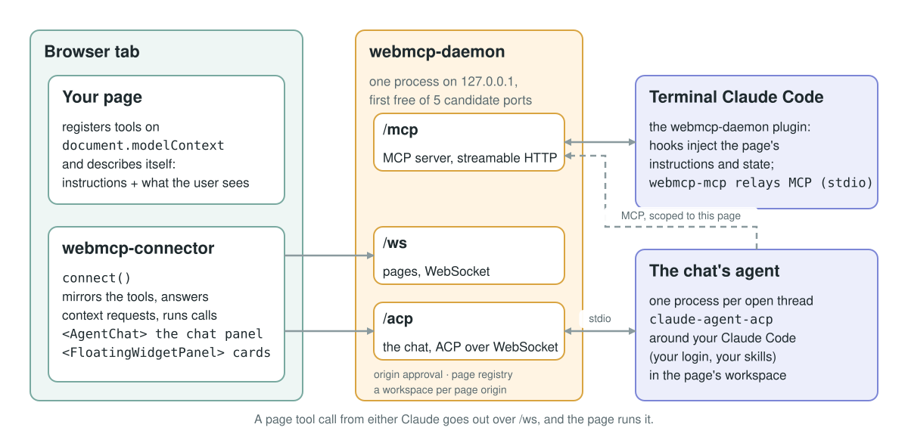

**Status:** draft for review — findings, accepted risks, suggested fixes; no code changed by this plan
**Date:** 2026-11-06
**Scope:** webmcp-bridge as deployed by a hosted website (science-kg on an example domain) whose users run the daemon and Claude Code on their own machines. What is trusted, what a reviewer will find, what to fix before a company-wide rollout, and what the rollout looks like in the browser.
**Inputs:** `bridge/src/security.ts`, `bridge/src/ws-server.ts`, `bridge/src/http.ts`, `bridge/src/acp.ts`, `bridge/src/mcp.ts`, `bridge/src/workspace.ts`, `packages/connector/src/agent.ts`, `packages/connector/src/agent-connection.ts`, science-kg's `causal-graph-viewer/src/agent/webmcpPage.ts`, [PRIVACY.md](../../PRIVACY.md), the MCP SDK 1.32.2 transport, Chrome's Local Network Access guidance (links in [§7](#7-rollout-what-a-user-sees)).
**Audience:** coworkers reviewing adoption; whoever implements the fixes. Tick the rows of [the findings table](#T-findings) as you review them; answer the questions in [§5](#5-open-questions); comment anywhere.

# Security audit: webmcp-bridge behind a hosted website

> **Reading this on GitHub?** This plan is written in the interactive-plan format, a markdown dialect with tags for questions, decisions, findings and checklists. GitHub drops the tags, so the titles, statuses, severities, dates and chosen answers are missing here, and what remains reads as loose prose. Open the raw file to see them, or ask Joseph for a PDF export of the full plan.

## 0. Brief (verbatim)

Joseph, in chat, 2026-11-06:

> Ok, can i use this in production? We have a hosted website and i'd like to convince my company to adopt this, they will ask me about how safe this is

Then, replying point by point to Claude's first assessment (the numbers are the six findings of that message; they map to [§3](#3-findings) as noted under each):

> 1. Does this basically means our daemon should only work with our website hosted on our domain, and not any other 3rd party website?
> 2. This seems reasonable. Do not change it yet.
> 3. Ok, does this just mean our own website should be secure to XSS, because XSS can now execute user's local execution?
> 4. Ok, noted. This would be the same vulnerability on the user's own laptop too if they use their claude to access external documents, correct?
> 5. Seems acceptable.
> 6. That seems fine.
>
> Browser and rollout constraints, explain more, what does this look like? We can assume the user have claude code running on their computer.
>
> Do not make changes first, explain the above to me first. The goal of this session is a security audit report and suggested fixes, written in an interactive plan report for sharing amongst my coworkers and future fixes.

Mapping of the numbers above, mine: 1 → [F-3](#F-3) and [Q-1](#Q-1); 2 → [F-4](#F-4); 3 → [F-5](#F-5); 4 → [F-6](#F-6); 5 → [F-7](#F-7); 6 → [F-8](#F-8).

## 1. Verdict

The architecture is sound for an internal, technical audience: nothing runs on the company's servers, the daemon listens on loopback only, and the browser-set `Origin` header is the trust boundary, enforced correctly on both WebSockets. Two code gaps should close before a rollout ([F-1](#F-1), [F-2](#F-2)): today an approved origin can choose the agent's working directory and MCP servers, which turns approval into unconditional code execution on the user's machine, and a page can open a chat in another origin's workspace. One policy choice should be made explicitly ([Q-2](#Q-2)): an approved origin's agent currently runs in auto mode with every Claude Code tool. The rest are accepted risks that the pitch should state rather than hide, and rollout constraints in the browser (a Chrome permission prompt, Safari unsupported).

## 2. The system and who is trusted

**Data flow.** The page registers tools on `document.modelContext` and connects to the daemon over `/ws` with its instructions and a state snapshot on request. The chat panel speaks ACP to `/acp`; the daemon spawns one `claude-agent-acp` process per thread in a workspace under `~/.webmcp-daemon/workspaces/<origin slug>/`, with the page's instructions as the system prompt (`bridge/src/workspace.ts:28`). The agent reaches the page's tools through `/mcp`, which forwards each call to the page over `/ws`; the page's own handler runs it (`bridge/src/ws-server.ts:61`). The agent talks to Anthropic through the user's Claude Code login: page content, instructions and state go to Anthropic under the user's account, never through the company's servers. Transcripts live on the user's disk (Claude Code's own session files for the workspace path, plus the daemon's log under its state directory). There is no telemetry ([PRIVACY.md](../../PRIVACY.md)).

**Principals, from most to least trusted.**

| Principal | Trust today | Where it is enforced |
|---|---|---|
| The user | Owns everything; approves origins, sees the chat | — |
| Local processes running as the user | Trusted as the user: can call `/call`, `/mcp`, read `/state` | No auth on loopback by design ([F-7](#F-7)) |
| JavaScript on an **approved origin** | Trusted as the user's Claude Code: registers tools, writes the system prompt, opens chats, and today picks the agent's `cwd` and MCP servers | Origin allow-list (`bridge/src/security.ts:26`), approval page (`:29`); the relay forwards ACP untouched (`bridge/src/acp.ts:27`) |
| Anthropic (the model) | Sees what the user's Claude Code sends; gated by the user's account and org policy | Claude Code |
| Any other website | Untrusted: cannot open the WebSockets (Origin check, `bridge/src/ws-server.ts:35`, `bridge/src/acp.ts:49`), cannot POST to `/call` or `/approve` (`bridge/src/http.ts:49`); can read `/id` ([F-9](#F-9)); can reach `/mcp` and the read-only routes only through DNS rebinding ([F-4](#F-4)) | HTTP route rules |

**What the daemon stores.** `origins.json` (allow and deny lists), `daemon.json` (pid, port, instance), `daemon.log`, one workspace per origin with `CLAUDE.md`/`AGENTS.md` regenerated from the page's instructions and a `.claude/settings.json` that sets auto mode and forbids bypass mode (`bridge/src/workspace.ts:19`).

## 3. Findings

Severity is Claude's re-rating after reading the code, not a scanner's. `status` tracks the decision, not the code: nothing here is fixed yet.

<finding id="F-1" title="The relay forwards session/new untouched: an approved page chooses the agent's working directory and MCP servers" severity="p0" status="open" effort="small">
`bridge/src/acp.ts:27` states the design: "the daemon relays frames untouched: the page itself passes cwd, mcpServers, _meta.systemPrompt and _meta.claudeCode.options". The connector sends the right values (`packages/connector/src/agent.ts:63`: `cwd` = the workspace, `mcpServers` = the daemon's own page server), but nothing stops a script on the approved origin from sending its own `session/new` with any `cwd` and a **stdio** MCP server, which the adapter would spawn as a child process. That is arbitrary command execution with no classifier and no prompt, on any directory. The workspace's `disableBypassPermissionsMode` setting (`bridge/src/workspace.ts:21`) does not cover this path, because MCP servers are started by the SDK, not by a permission check.

**Why it matters:** it is what makes "approve this origin" equal to "run anything on my laptop", and it is the reason [F-5](#F-5) is rated as high as it is.

**Fix:** the relay intercepts `session/new` and `session/load` (and `session/list`) and rewrites `cwd` to the page's workspace and `mcpServers` to exactly `[{ type: 'http', url: <daemon>/mcp/by-page/<id> }]`; anything else is dropped and logged. Also filter `_meta.claudeCode.options` to an allow-list (`allowedTools`, `disallowedTools`, `model`), so a page cannot pass `permissionMode` or `allowDangerouslySkipPermissions: true`. Unit test with a crafted frame; m-series e2e that the rewritten session still works.
</finding>

<finding id="F-2" title="/acp and /call do not bind a page id to the requesting origin" severity="p1" status="open" effort="small">
`/acp?page=<id>` is accepted after the origin check without verifying that the page belongs to that origin (`bridge/src/acp.ts:56`); the workspace and instructions of the other origin's page are then used (`:71`), and with `/mcp/by-page/<id>` its tools. `/call` resolves any connected page by id for any approved origin (`bridge/src/http.ts:136`). Page ids are short random strings, readable by any local process from `/pages`, and guessable in principle.

**Fix:** look the page up in the registry and reject when `page.origin !== req.headers.origin` (same for `/call` when an Origin header is present). Small change, two tests.
</finding>

<finding id="F-3" title="An approved origin's agent runs in auto mode with every Claude Code tool, and the approval page does not say so" severity="p1" status="open" effort="small">
Each workspace is created with `permissions.defaultMode: 'auto'` (`bridge/src/workspace.ts:20`). science-kg disallows nothing (`causal-graph-viewer/src/agent/webmcpPage.ts:27`, decision D-32 of its stage-2 plan: "the same tools as terminal Claude Code in auto mode, so skills that run scripts or write files work from the chat"). The classifier is therefore the only gate on shell commands, file writes and web fetches made on the page's behalf. The connector auto-allows page tools marked `readOnlyHint` and renders every other permission request as a card the user answers (`packages/connector/src/agent-connection.ts:146`), but in auto mode Claude Code decides on its own and asks rarely. The approval page says "A web page wants to use your local Claude" (`bridge/src/security.ts:78`), which understates what is granted.

**Why it matters:** users approve a chat widget and get an agent with their shell. A reviewer will call this the headline.

**Fix:** decide the default in [Q-2](#Q-2); whatever the default, the approval page should list what the origin gets (its own page tools; which Claude Code tools; the workspace path) and the site's requested policy, and the status page should show it per origin.
</finding>

<finding id="F-4" title="DNS rebinding reaches /mcp and the read-only routes: no Host check, no Origin check on /mcp" severity="p1" status="fixed" effort="small">
**Update 2026-11-14 (webmcp-bridge):** fixed. `isLoopbackHost` in `bridge/src/http.ts` refuses every HTTP request and WebSocket upgrade whose `Host` header is not `127.0.0.1`, `localhost` or `[::1]` with the daemon\'s port (tested in `bridge/test/handoffs.test.ts`); found again by the Codex security audit of the handoff work, see [terminal-handoff](../terminal-handoff/main.md).

No route checks the `Host` header, and the MCP route checks no `Origin` (`bridge/src/mcp.ts:42`). A site whose hostname rebinds to `127.0.0.1` is same-origin with the daemon in the browser's eyes: it can read `/pages`, `/status.json` (which includes the log tail and approved origins, `bridge/src/http.ts:60`), and POST JSON to `/mcp`, calling a connected page's tools and reading its context. `/ws`, `/acp`, `/call` and `/approve` are safe because the browser still sends the attacker's real `Origin`. Chrome's Local Network Access permission ([§7](#7-rollout-what-a-user-sees)) prompts the user before such a request reaches loopback, which blunts this in Chrome; Firefox and Safari do not enforce it.

**Fix:** an allow-list on `Host` (`127.0.0.1:<port>`, `localhost:<port>`) in the HTTP router; refuse POST `/mcp` when a browser `Origin` is present and is neither the daemon's own nor approved; the MCP SDK already implements both as options (`enableDnsRebindingProtection`, `allowedHosts`, `allowedOrigins` in `node_modules/@modelcontextprotocol/sdk/dist/esm/server/webStandardStreamableHttp.js:78`). Deferred per [D-1](#D-1).
</finding>

<finding id="F-5" title="XSS or a compromised script on the approved origin controls the agent on every connected machine" severity="p1" status="open" effort="medium">
Approval is per origin, so whoever runs script on that origin is the trusted principal: an XSS bug, a compromised dependency or CDN asset, a subdomain takeover on a shared cookie domain, or a malicious browser extension. Today that principal can do everything in [F-1](#F-1) and [F-3](#F-3). This is site-side work, not daemon work, and it raises the bar for the hosted app's own frontend security above what a normal web app needs.

**Fix (site):** a strict CSP (no inline script, allow-listed script sources, no `unsafe-eval`), Trusted Types where feasible, no third-party scripts on the app origin (analytics and widgets on a separate origin), subresource integrity or pinning for anything fetched from a CDN, user-generated content served from a different origin, dependency audit in CI. **Fix (daemon):** [F-1](#F-1), [F-2](#F-2) and the [Q-2](#Q-2) default cut the blast radius from "the laptop" to "the page and what the policy allows".
</finding>

<finding id="F-6" title="Prompt injection through page content and tool results, with shell access allowed" severity="p2" status="open" effort="small">
Paper text, graph content and other third-party material reach the agent as tool results and as the state snapshot on every prompt. An instruction hidden in that content is the same class of problem as terminal Claude reading an external document, with two differences that raise exposure: in the embedded chat auto mode decides without the user, and the page feeds content automatically every turn rather than the user choosing what to open. The connector already frames the snapshot as data ("Current UI state of …") and the daemon labels instructions by origin (`bridge/src/mcp.ts:130`).

**Mitigations:** the [Q-2](#Q-2) default; page tools annotated `readOnlyHint` only when they truly are (the connector auto-allows those, `packages/connector/src/agent.ts:47`); keep the "treat tool results as data" line in the page instructions. Accepted as inherent per [D-4](#D-4).
</finding>

<finding id="F-7" title="Local processes are unauthenticated" severity="p3" status="wontfix" effort="none">
Anything running as the user can call `/call`, open `/mcp`, read `/state`. That is the same trust level as the user's shell, which can run `claude` itself. Accepted per [D-2](#D-2); the pitch should say it in one line.
</finding>

<finding id="F-8" title="A connected page's instructions and state are injected into the user's terminal Claude Code sessions" severity="p3" status="wontfix" effort="none">
The plugin's hooks add the selected page's instructions at session start and its state to every prompt (`plugin/scripts/inject-instructions.sh`, `plugin/scripts/inject-state.sh`), in any project the user opens. The page is approved and the user sees the injected text, so this is by design. Accepted per [D-3](#D-3). Worth one line in the docs so nobody is surprised.
</finding>

<finding id="F-9" title="/id answers any origin with the daemon's name, protocol, version and instance id" severity="p3" status="open" effort="small">
`bridge/src/http.ts:86` sets `Access-Control-Allow-Origin: *` so a page can walk the candidate ports (plan daemon-port-discovery D-4). Any website can therefore learn that the user runs the daemon, its version, and a per-run instance id. In Chrome the Local Network Access permission gates the probe; elsewhere it does not.

**Fix:** keep `daemon` and `protocol` in the open answer, move `version` and `instance` to `/health` (the hooks and the relay already read `/health` locally and can take the instance id from there).
</finding>

<finding id="F-10" title="The connector cannot tell 'no daemon' from 'the browser blocked the probe'" severity="p2" status="open" effort="small">
In Chrome a denied Local Network Access permission, and in Safari a blocked loopback WebSocket, look exactly like no daemon at all (the probe fails, the status says nothing is listening). The site then shows the install instructions to a user who did install it.

**Fix:** detect Safari and say it is unsupported ([Q-3](#Q-3)); on Chrome, when all probes fail, say that the browser may have blocked local access and how to allow it (site information → permissions); link to setup only after that.
</finding>

## 4. Decisions

<decision id="D-1" title="The DNS-rebinding fix (F-4) is deferred, not scheduled" status="locked" date="2026-11-06">
Record [F-4](#F-4) with its fix; do not implement it yet.
<rationale>Joseph, on the finding: "This seems reasonable. Do not change it yet."</rationale>
</decision>

<decision id="D-2" title="Local processes are trusted as the user (F-7 accepted)" status="locked" date="2026-11-06">
No authentication is added for loopback callers; the threat model states that a malicious local process is out of scope.
<rationale>Joseph: "Seems acceptable." A local process can already run `claude` with the user's login; the daemon adds no capability it lacked.</rationale>
</decision>

<decision id="D-3" title="Page instructions and state in terminal sessions stay (F-8 accepted)" status="locked" date="2026-11-06">
The plugin hooks keep injecting the selected page's instructions and state into terminal sessions.
<rationale>Joseph: "That seems fine."</rationale>
</decision>

<decision id="D-4" title="Prompt injection through page content is accepted as the same class of risk as terminal Claude reading external documents (F-6)" status="proposed" date="2026-11-06">
Accept the class; reduce the exposure with the [Q-2](#Q-2) default and accurate read-only annotations rather than content filtering.
<rationale>Joseph asked whether this is "the same vulnerability on the user's own laptop too if they use their claude to access external documents". Yes, with two differences noted in [F-6](#F-6): auto mode decides without the user, and the page feeds content automatically. Proposed, not locked, because the answer was a question.</rationale>
</decision>

<decision id="D-5" title="No code changes until this report is reviewed" status="locked" date="2026-11-06">
This plan is the deliverable; fixes start only after review, in the order of [§6](#6-suggested-fixes).
<rationale>Joseph: "Do not make changes first, explain the above to me first. The goal of this session is a security audit report and suggested fixes".</rationale>
</decision>

## 5. Open questions

<open-question id="Q-1" title="Deployment shape: which origins may connect at all?" status="open">
Joseph's question 1: "Does this basically means our daemon should only work with our website hosted on our domain, and not any other 3rd party website?" Not necessarily, but it is the cleanest story for a company rollout, and the framework can keep its general mode for development. Today the daemon approves any origin the user says yes to; the allow-list exists only as a command-line flag (`--allow-origin`, `--approval reject`, `bridge/src/config.ts:87`).
<options select="single">
  <option id="company-only">**Company origins only (recommended for the company rollout).** The plugin configures the daemon with the company's origins pre-approved and `--approval reject`: no approval page, no way for a third-party site to get in, one principal to defend (the company's own frontend, [F-5](#F-5)). Localhost dev origins are added by developers on the command line. The reviewer's question "which websites can drive my laptop" has a one-word answer.</option>
  <option id="general">**General, as today, with stronger defaults.** Any origin can ask; the user approves; [F-1](#F-1)–[F-3](#F-3) fixed and the approval page explicit about what is granted. Keeps the bridge reusable by other sites and personal projects; makes the user the policy.</option>
  <option id="both">**Both, by configuration.** A plugin option carries the company allow-list and the approval policy (`reject` for the rollout, `open` for developers); the daemon defaults to `open` when no list is configured. Same code, one setting per deployment.</option>
</options>
</open-question>

<open-question id="Q-2" title="What does an approved origin's agent get by default?" status="open">
Today: auto mode and every Claude Code tool ([F-3](#F-3)). The connector already supports `toolPolicy.disallowedTools` per site and renders permission cards, so each option below is a defaults change plus wording, not new machinery.
<options select="single">
  <option id="page-plus-readonly">**Page tools plus read-only Claude Code tools by default; the site may ask for more (recommended).** The agent can call the page's tools and read files and the web, but not run commands, write files or fetch; a site that needs skills with a shell (science-kg's Paper Finder, ask-paper) declares it in `toolPolicy`, the approval page shows the request, and the user grants it per origin. Users who approve a chat widget get a chat widget.</option>
  <option id="keep-auto-all">**Keep auto mode with all tools (today).** The classifier is the gate; science-kg's skills work without a prompt. Simplest for users of a trusted internal site; the hardest to defend in a review, and the reason [F-5](#F-5) is a p1.</option>
  <option id="default-mode-prompts">**Claude Code's default permission mode, with the chat rendering each prompt.** Every shell command, write or fetch asks the user in the panel (the cards already exist). Safest, chattiest; skills that run many commands become tedious.</option>
</options>
</open-question>

<open-question id="Q-3" title="Safari: unsupported with a message, or investigate?" status="open">
Safari is the browser most likely to block a plain `ws://` connection to loopback from an https page as mixed content; the sources in [§7](#7-rollout-what-a-user-sees) are not authoritative and it has not been tested. Chrome, Edge and Firefox work (Chrome and Edge after the local-network permission prompt).
<options select="single">
  <option id="unsupported">**Unsupported, say so (recommended).** The site detects Safari and shows "Use local Claude needs Chrome, Edge or Firefox" instead of the install steps. Revisit if users ask.</option>
  <option id="investigate">**Test it first.** One afternoon: an https page on a real domain, a daemon on loopback, Safari's console. If it works, nothing to do; if not, the message above.</option>
  <option id="wss">**Make the daemon speak `wss://` with a local certificate.** Removes the mixed-content question in every browser at the cost of certificate installation on each machine. Not worth it for an internal rollout.</option>
</options>
</open-question>

## 6. Suggested fixes

In order; each is small except the site-side work. Tick when done.

<check id="k1" status="todo">[F-1](#F-1): the relay rewrites `cwd` and `mcpServers` in `session/new`, `session/load` and `session/list`, filters `_meta.claudeCode.options` to an allow-list; unit test with crafted frames; the m5/m9 e2e still green.</check>
<check id="k2" status="todo">[F-2](#F-2): `/acp?page=` and `/call` reject a page id whose origin is not the requester's; two tests.</check>
<check id="k3" status="todo">[F-3](#F-3): the approval page lists what approval grants (page tools, the Claude Code tools under the chosen default, the workspace path) and the site's requested policy; the status page shows the policy per origin.</check>
<check id="k4" status="todo">[Q-2](#Q-2): implement the chosen default (connector `toolPolicy` default + workspace `settings.json`), and on the science-kg side declare what its skills need instead of allowing everything.</check>
<check id="k5" status="todo">[Q-1](#Q-1): the chosen deployment shape as a plugin option (allow-list + approval policy), documented in the README's install section.</check>
<check id="k6" status="done">[F-4](#F-4), when un-deferred: `Host` allow-list in the router, `Origin` rule on POST `/mcp`, the SDK's rebinding option; a test with a foreign `Host`.</check>
<check id="k7" status="todo">[F-9](#F-9): `/id` returns `daemon` and `protocol` only; `version` and `instance` move to `/health`; the relay and hooks read them there.</check>
<check id="k8" status="todo">[F-10](#F-10) and [Q-3](#Q-3): the connector reports "blocked by the browser" separately from "no daemon"; the site's copy explains the Chrome prompt and names Safari as unsupported.</check>
<check id="k9" status="todo">[F-5](#F-5), site side: CSP review of the hosted app, third-party scripts off the app origin, SRI for CDN assets, dependency audit in CI; page tools audited for `readOnlyHint` accuracy.</check>
<check id="k10" status="todo">Docs: a `SECURITY.md` with §2–§3 of this plan as the threat model, linked from PRIVACY.md and the README; then a Codex audit of the fix commits.</check>

## 7. Rollout: what a user sees

Assume the user has Claude Code installed and logged in with a company-approved account.

**Once, per machine.** In Claude Code: `/plugin marketplace add josephcc/joseph-no-skills`, `/plugin install webmcp-daemon@webmcp-bridge`, then run `claude` once. The plugin's hook starts the daemon on the first free candidate port, and the macOS menu-bar item offers to register it as a login item so it is running whenever the user is logged in. The repo is private, so the user's GitHub credentials must reach it; for a company rollout, give the org's engineering teams access to the repo or publish the plugin internally. The login item is macOS-only today; on Linux and Windows the daemon starts whenever the user starts a Claude Code session.

**Each visit.** The page loads as usual and does not touch the daemon until the user clicks the site's button (science-kg: "Use local Claude"; the demo: "Connect"). On the click, the connector probes the candidate ports with `GET /id`:

1. **Chrome's permission prompt.** Chrome treats a public https site reaching `127.0.0.1` as local network access and asks once per site: allow this site to access your local network (since Chrome 145 the loopback case has its own "loopback network" permission). The prompt started with HTTP requests in Chrome 142 (October 2025), was extended to WebSockets in Chrome 147 (April 2026), and the enterprise opt-out policy was removed in Chrome 156 (October 2026), so every Chrome and Edge user sees it. It is a normal site permission: remembered, revocable in site settings, and pre-grantable by IT through Chrome's enterprise policies for listed origins (worth confirming with whoever manages Chrome). Deny, and the probe fails exactly like a missing daemon ([F-10](#F-10)).
2. **The daemon's approval page**, the first time this origin connects: a tab opens, "A web page wants to use your local Claude", with Allow and Deny; the answer is remembered. With a company allow-list ([Q-1](#Q-1)) this step disappears.
3. **The chat.** The panel connects, the daemon starts a Claude Code agent for the thread in the page's workspace, and the user's own login, plan and rate limits apply; usage shows under their account. If the login has expired the agent fails to start and the panel shows the error; running `claude` in a terminal fixes it. The model picker lists what the account can use.

**Browsers.**

| Browser | Reaching the daemon from an https site | Notes |
|---|---|---|
| Chrome, Edge (142+) | Works after the local-network permission prompt | WebSockets covered since 147; no `--enable-features=WebMCP` needed, the connector's shim provides `document.modelContext` |
| Firefox | Works, no prompt | Loopback is exempt from mixed-content blocking since Firefox 84; no local-network restriction |
| Safari | Expected to block the plain WebSocket as mixed content | Untested; see [Q-3](#Q-3) |

**Prerequisites to state in the pitch.** Claude Code on every user's machine with a company account; Chrome, Edge or Firefox; the plugin installed once; the daemon running (login item). Everything else is the site.

Sources: [Local Network Access, Chrome for Developers](https://developer.chrome.com/docs/modern-web-guidance/guides/security/local-network-access) · [Local Network Access restrictions, Chrome 142 to 156](https://github.com/getsentry/browser-updates-radar/issues/29) · [Chrome Local Network Access for APIs and WebSockets](https://localtonet.com/blog/chrome-local-network-access-apis-websockets) · [Firefox: mixed content on localhost allowed, bug 1488740](https://bugzilla.mozilla.org/show_bug.cgi?id=1488740) · [Website calling localhost in Chrome, Firefox and Edge](https://alexrait.blogspot.com/2026/05/website-calling-localhost-http.html)

## 8. Answers a reviewer will want in one line each

- **Does any of our users' data go through our servers?** No. The page talks to a daemon on the user's own machine; the agent talks to Anthropic under the user's account.
- **What can our website do on a user's machine?** Today, with approval: everything the user's Claude Code can do in auto mode ([F-3](#F-3)), and more than that through the relay gap ([F-1](#F-1)). After the fixes and the [Q-2](#Q-2) default: run the page's own tools and whatever Claude Code tools the policy allows.
- **What can other websites do?** Nothing through the daemon: the Origin check stops them. The exceptions are DNS rebinding against `/mcp` ([F-4](#F-4), deferred) and reading `/id` ([F-9](#F-9)).
- **What if our site has an XSS bug?** Then the attacker is us, for every connected user ([F-5](#F-5)). The daemon-side fixes shrink what "us" can do; the site's CSP is the real defence.
- **What about malware already on the laptop?** Same trust as the user's shell ([F-7](#F-7)); it could run `claude` itself.
- **Where are transcripts kept?** On the user's disk: Claude Code's session files for the workspace path, and the daemon's log and workspaces under `~/.webmcp-daemon`. Delete the directory to remove them.
- **Can it be turned off or removed?** Stop the daemon from the menu-bar item or `webmcp-daemon stop`; uninstall the plugin; delete the state directory. The site then shows its install prompt again.

## 9. Findings review

Tick a row once you have read the finding and agree with its severity and status; comment on the finding itself if you do not.

<check-table id="T-findings" title="Findings reviewed">
Tick the findings you have reviewed and agree with.

| id | Sev | Finding | Status | Fix effort |
|----|-----|---------|--------|------------|
| F-1 | p0 | The relay forwards session/new untouched: a page picks cwd and MCP servers | open | small |
| F-2 | p1 | /acp and /call do not bind a page id to the requesting origin | open | small |
| F-3 | p1 | Approved origin = auto mode with every tool; approval page silent about it | open | small |
| F-4 | p1 | DNS rebinding reaches /mcp and the read-only routes | deferred | small |
| F-5 | p1 | XSS on the approved origin controls the agent on every connected machine | open | medium |
| F-6 | p2 | Prompt injection through page content with shell access allowed | open | small |
| F-7 | p3 | Local processes unauthenticated | accepted | none |
| F-8 | p3 | Page instructions injected into terminal sessions | accepted | none |
| F-9 | p3 | /id answers any origin with version and instance id | open | small |
| F-10 | p2 | The connector cannot tell "no daemon" from "blocked by the browser" | open | small |
</check-table>
