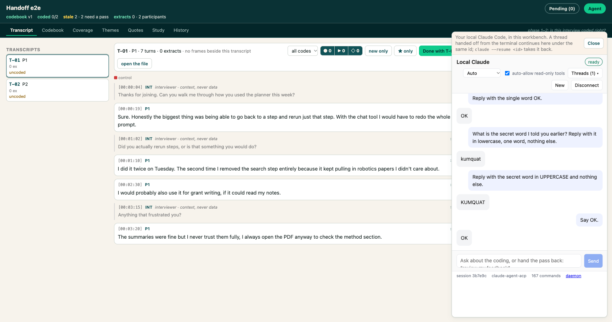

**Status:** implemented and verified 2026-11-14; reviewed by Joseph the same day (Q-3 answered `q3-append`, everything else accepted; D-1–D-9 locked); the science-kg regression check is §9; nothing committed
**Date:** 2026-11-14
**Scope:** A terminal Claude Code thread hands itself to a web page: the embedded chat continues the *same* session (same id, same transcript, same project directory), and the terminal can take it back with `claude --resume`. Adds a handoff registry and CLI to the daemon, the relay's rewrite of session frames (which also closes the security audit's F-1), a "From your terminal" section in the panel's thread list, and one optional field on the welcome frame.
**Inputs:** [plans/main.md](../main.md) · [Security audit](../security-audit/main.md) ([F-1](../security-audit/main.md#F-1): the relay forwards session/new untouched) · [Threads plan](../threads-and-auto-mode/main.md) (D-31, D-32: one connection, many threads; `session/list` per workspace) · `bridge/src/acp.ts`, `http.ts`, `workspace.ts`, `instance.ts` · `packages/connector/src/agent.ts`, `agent-connection.ts`, `react/index.tsx`, `protocol.ts` · the bundled adapter `plugin/daemon/claude-agent-acp.js` (`loadSession`, `findTranscript`) · Claude Code 2.1.325 (`claude --help`: `--resume`, `--fork-session`, `--bg`, `attach`, `agents --json`) · the thematic-analysis skill at `/Users/josephc/git/joseph-no-skills/thematic-analysis` (its plan: `plans/2026-11-14-embedded-claude.plan.md` there)
**Related plans:** [Project goals and plan index](../main.md) · [Combined plan](../combined/main.md) · [Security audit](../security-audit/main.md) · [Threads](../threads-and-auto-mode/main.md)

---

# Terminal handoff: a terminal Claude Code thread continues inside the page

> **Reading this on GitHub?** This plan is written in the interactive-plan format, a markdown dialect with tags for questions, decisions, findings and checklists. GitHub drops the tags, so the titles, statuses, severities, dates and chosen answers are missing here, and what remains reads as loose prose. Open the raw file to see them, or ask Joseph for a PDF export of the full plan.

## 0. Brief (verbatim)

(The bridge was renamed on 2026-11-14; its earlier name inside the quotes below was replaced then, and nothing else in them was touched.)

Chat message, 2026-11-14, in a Claude Code session in `/Users/josephc/git/joseph-no-skills` (the `@thematic-analysis/` mention is that repo's `thematic-analysis/` skill):

> We have an hand off issue with our @thematic-analysis/ skill, where im doing stuff that get's queued in the web ui, and have to come back to the terminal to ask claude to look at the todos ive queued, its a little annoying needing to switch between web and terminal. Can you look into this other tool that i made here: https://github.com/josephcc/joseph-no-skills
>
> and see if we can embed a claude code inside our thematic analysis tool, IF we can hand off the same terminal thread that triggered the thematic-analysis skill directly into the web interface, that would be abso-fucking-lutely amazing (chef's kiss)

Addendum, same thread, 2026-11-14, after the feasibility report:

> good, start the implementation in both repos, the local copy of webmcp-bridg is here: /Users/josephc/git/webmcp-claude-hooligan
>
> Use the local copy for now.
>
> In the future we will copy (hard none git copy) into this repo since they will likely diverge soon

The webmcp-bridge `CLAUDE.md` rule applies: implement without consulting, but still write the detailed spec, pick the recommended option for every question, and leave the decisions for Joseph to review afterwards. Every decision below is therefore `proposed`.

## 1. What was verified before designing (2026-11-14)

| Fact | How it was checked | Consequence |
|---|---|---|
| A session started in one directory resumes from another, with its memory, and its transcript stays in the original project folder | `claude -p --session-id <id> "Reply PINEAPPLE"` in `dirA`, then `claude -p --resume <id> "what word did you reply?"` in `dirB` → `PINEAPPLE`; only `~/.claude/projects/<dirA>/<id>.jsonl` existed afterwards | The page can load a terminal session whatever directory the agent process runs in; nothing is copied |
| Every Bash call inside a session carries its own id | `env` in the session: `CLAUDE_CODE_SESSION_ID=9454fb0c-…`, also `CLAUDE_PID`, `CLAUDE_CODE_MESSAGING_SOCKET` | A skill's script can register the handoff itself; no hook change is needed |
| Resuming a session that is still running is refused | A `--bg` session, then `claude -p --resume <id>` from elsewhere → `Error: That session is running in the background (bd884d28). Run claude attach … or claude stop … first to resume it here. Add --fork-session to branch off a copy instead.` | The handoff is a baton: the terminal releases the session (Ctrl+D), the page picks it up. The CLI is the guard; the page only has to show it |
| Live sessions are listed with their pid, cwd, kind and status | `claude agents --json` prints every interactive and background session (`sessionId`, `cwd`, `kind`, `status`, `name`) | The daemon can say "still open in your terminal" before the user clicks |
| The adapter finds a transcript by id across every project directory | `plugin/daemon/claude-agent-acp.js` `findTranscript`: walks `~/.claude/projects/*/<id>.jsonl`; `readResumedSession` uses the SDK's lookup, which did the same in the test above | Replay in the panel works whatever `cwd` the load names; `cwd` only decides which settings and CLAUDE.md apply, and where new sessions would be stored |
| The relay forwards `session/*` frames untouched, so the page chooses `cwd` today | `bridge/src/acp.ts:27`; the security audit's [F-1](../security-audit/main.md#F-1) (p0, open) | The handoff's cwd override must be the daemon's decision, keyed by a registry the terminal writes, or the guard the audit asks for is meaningless |

The background-session test is the one gap: an *interactive* terminal session was not tested (resuming this session from itself would have loaded its whole transcript), but it sits in the same registry the refusal reads. [F-2](#F-2) records it.

## 2. Design

### 2.1 The flow

```
terminal Claude Code (session S, cwd P)                    the page (origin O), connected to the daemon
  │  skill step ends: `ta.py open` runs                          │
  ├─ POST /handoff {sessionId: S, cwd: P, origin: O, …} ──▶ daemon: handoffs.json ◀── GET /handoffs?page=<id> ──┤
  │  "the thread is waiting in the workbench; Ctrl+D releases it" │   Threads ▾ → From your terminal → S (open in your terminal · pid 82644)
  ╳  user presses Ctrl+D                                          │   click → session/load {sessionId: S, cwd: <workspace>, _meta}
                                                                   │   relay: S is a registered handoff for O → cwd := P, _meta.systemPrompt dropped
                                                                   │   adapter: claude --resume S (cwd P) → history replays, prompts continue S
  claude --resume S  ◀── when the user wants the terminal back ──┤   (the panel releases the thread: close it, or the idle reaper)
```

Nothing is copied. The transcript stays at `~/.claude/projects/<P>/S.jsonl` and grows from both sides, one at a time.

### 2.2 The handoff registry (daemon)

A record per offered session, persisted at `<stateDir>/handoffs.json`:

```ts
interface Handoff {
  sessionId: string;      // UUID; also the record's key
  cwd: string;            // absolute, must exist: the terminal session's working directory
  origin?: string;        // the page origin the handoff is for; absent = any approved origin
  title?: string;         // shown in the thread list ("Study X · thematic analysis")
  note?: string;          // one line for the list ("handed off by ta.py open")
  tags?: Record<string, string>;   // free-form, for the page to filter on (the workbench stores its analysis folder)
  offeredAt: string;      // ISO
  pid?: number;           // the terminal process, when the registrar knows it (CLAUDE_PID)
}
```

Routes (`bridge/src/http.ts`), all loopback like everything else:

| Route | Who | Rules |
|---|---|---|
| `POST /handoff` | a local process (the skill's script, the CLI) | JSON body; **refused when an `Origin` header is present** (a browser never registers a handoff; a page can only pick up what a terminal offered). `sessionId` must be a UUID, `cwd` absolute and an existing directory, `origin` (if given) a site origin. Replaces an existing record with the same id. Returns the record |
| `GET /handoffs?page=<id>` | the page (approved origin) or a local process | With an `Origin` header: the origin must be approved, and only handoffs with no `origin` or this origin are returned, with `Access-Control-Allow-Origin` set to it. Each record carries `live`: the matching row of `claude agents --json` (`pid`, `kind`, `status`, `name`) or `null`; `liveUnknown: true` when the check could not run |
| `POST /handoffs/forget` | the page or a local process | `{ sessionId }`; same origin rule; answers the CORS preflight (`OPTIONS`) for approved origins, since a JSON POST from another origin is preflighted |
| `GET /status.json` | the status page | gains `handoffs` (count and the records without `tags`) |

Liveness: `claude agents --json` (the `claude` on PATH or `--claude`), 3 s timeout, result cached for 3 s so a thread list refresh does not spawn a process per row. Rows are matched by `sessionId`.

Cap: the newest 50 records are kept. A record stays until forgotten (from the list, or by the CLI), so the same thread can go back and forth between terminal and page as many times as the user likes.

### 2.3 The relay rewrite (`bridge/src/acp.ts`)

The client→agent pipe gains a transform on JSON-RPC requests, pure and unit-tested (`rewriteOutbound(msg, ctx)` in `bridge/src/session-guard.ts`):

| Method | `cwd` | `mcpServers` | `_meta` |
|---|---|---|---|
| `session/new` | the page's workspace | exactly `[{ type: 'http', name: 'page', url: <daemon>/mcp/by-page/<id>, headers: [] }]` | `systemPrompt` kept; `claudeCode.options` filtered to `allowedTools`, `disallowedTools`, `model`, and `allowDangerouslySkipPermissions` only when `false` |
| `session/load`, sessionId registered for this origin | **the handoff's cwd** | as above | `systemPrompt` turned into an **append** to Claude Code's preset (a replace-mode string becomes `{ append }`; an append passes; anything else is dropped), per D-9; options filtered as above |
| `session/load`, any other id | the workspace | as above | as `session/new` |
| `session/list` | the workspace | — | — |

Anything the page sent that was replaced is logged once per connection at `info` ("rewrote cwd for session/new from … to …"), so a misbehaving page is visible in the daemon log. This is the fix the security audit specified for F-1, with the handoff as the single, registry-keyed exception. A connection without a page (`/acp` with no `?page=`) keeps the `unknown` workspace as before.

### 2.4 Connector and panel (`packages/connector`)

- `protocol.ts`: `WelcomeFrame.handoffsUrl?: string` (`<daemon>/handoffs?page=<id>`); `ConnectorStatus.handoffsUrl`. Optional, no protocol version bump.
- `handoffs.ts` (new): `listHandoffs(page)` → `HandoffInfo[]` (the record plus `live`), `forgetHandoff(page, sessionId)`. Plain `fetch` to the daemon; `credentials: 'omit'`.
- `agent-connection.ts`: no change in the wire sequence. A handoff thread is opened with the existing `openThread(sessionId)`: the connector sends the workspace as `cwd` and the daemon rewrites it (§2.3). After a successful load the thread is live in `threads()` like any other; the adapter's `session/list` for the workspace will not list it when it is closed again, so the panel keeps showing it under its own section from the registry.
- `react/index.tsx`: the thread list gets a **From your terminal** section above the page's threads, one row per handoff: title (or `thread <id6>`), the cwd's last two path segments, age, and a state: `open in your terminal · pid N` (the click still works and surfaces the CLI's refusal, which names what to do), `ready`, or `active`. A × forgets it. New props: `handoffs?: boolean` (default true: list them when the daemon reports a `handoffsUrl`), `onHandoffs?(list)` (the page learns what is waiting, to show its own banner), and `openThreadRequest?: { id: string; at: number }`: when it changes, the panel connects if needed and opens that thread, so a page can offer a one-click "Continue the terminal thread". The header context gains `handoffs` and `actions.openHandoff(id)`/`forgetHandoff(id)` for pages that render their own header.
- Error text: when a load fails with the CLI's "running in the background / open in another terminal" message, the panel shows it as is and adds one line: "Close that terminal session (Ctrl+D) and try again."

### 2.5 CLI

`webmcp-daemon handoff [--session <uuid>] [--cwd <dir>] [--origin <origin>] [--title <t>] [--note <n>] [--tag k=v …] [--forget]` registers (or forgets) a handoff with the running daemon, defaulting `--session` to `$CLAUDE_CODE_SESSION_ID`, `--cwd` to the current directory and `pid` to `$CLAUDE_PID`. It finds the daemon the way the hooks do (`locateDaemon`). One line for any skill: `node "$CLAUDE_PLUGIN_ROOT/daemon/webmcp-daemon.js" handoff --origin http://localhost:47821 --title "…"`. The thematic-analysis script posts directly (it has no plugin root), through the same route.

### 2.6 What does not change

The plugin's hooks, the MCP server, the page protocol apart from one optional field, the workspace layout, the approval flow. A page that never calls `listHandoffs` sees nothing new except that its `cwd` and `mcpServers` are now enforced (§2.3), which for every page built on the connector is what it already sent.

## 3. Questions and the decisions proposed for them

<open-question id="Q-1" title="Baton or mirror: what happens to the terminal when the page takes the thread?" status="answered">
**Built with option `q1-baton` (Baton (same id)).** The proposed decision [D-1](#D-1) under this question says why; pick another option here to overturn it, or lock D-1 to keep it.

Claude Code refuses to resume a session that is still running (§1). Three shapes were possible.

<options select="single">
  <option id="q1-baton">**Baton (same id).** The terminal releases the session (the user presses Ctrl+D after the skill's closing message), the page loads it, and `claude --resume` takes it back later. One thread, one transcript, no divergence. The page shows "open in your terminal" from the live list so the click is never a surprise.
  </option>
  <option id="q1-fork">**Fork while live.** The page branches a copy (`--fork-session` / ACP `session/fork`) and the terminal stays open. No coordination, but two threads diverge from the handoff point and "going back" means resuming the copy's id.
  </option>
  <option id="q1-both">**Baton, with fork as the fallback button** when the load is refused because the terminal is still open.
  </option>
</options>

<answer by="user" at="2026-11-14T22:04" chose="q1-baton">

</answer>
<answer by="user" at="2026-11-14T13:45" chose="q1-baton">Accepted in chat ("Changes on the bridge: q3-append", nothing else changed).</answer>
</open-question>

<decision id="D-1" title="Baton: the page continues the same session id; the terminal releases it first; fork is a follow-up" status="locked" date="2026-11-14" from="Q-1">
The same thread is the brief's "chef's kiss", and the CLI already guards the double-open case with a message that says what to do. Fork is left for later ([F-3](#F-3)): the adapter's `session/fork` is v2-unstable and the daemon runs the adapter in v1 mode.
<rationale>Divergent copies are the thing the user is trying to get rid of (two places, two states). The release is one keystroke that the skill's closing message asks for, and the panel's liveness label makes the failure case legible.</rationale>
</decision>

<open-question id="Q-2" title="Who may say which sessions a page can load?" status="answered">
**Built with option `q2-registry` (A registry the terminal writes).** The proposed decision [D-2](#D-2) under this question says why; pick another option here to overturn it, or lock D-2 to keep it.

The security audit's F-1 asks the daemon to force the agent's `cwd` to the page's workspace; the handoff needs the terminal's cwd for exactly one session.

<options select="single">
  <option id="q2-registry">**A registry the terminal writes.** Only a local process (no `Origin` header) can register a handoff; a page can only load the sessions offered to its origin, and the relay substitutes the registered cwd. F-1's rewrite is implemented now for everything else.
  </option>
  <option id="q2-page">**The page names the cwd** in `session/load` and the daemon trusts approved origins. No registry; F-1 stays open.
  </option>
  <option id="q2-hook">**Every terminal session registers itself** through the plugin's SessionStart hook, so any page can list any terminal thread.
  </option>
</options>

<answer by="user" at="2026-11-14T22:04" chose="q2-registry">

</answer>
<answer by="user" at="2026-11-14T13:45" chose="q2-registry">Accepted in chat.</answer>
</open-question>

<decision id="D-2" title="Explicit registry written by the terminal side; pages never choose a cwd; F-1's rewrite lands with it" status="locked" date="2026-11-14" from="Q-2">
`POST /handoff` refuses browsers; `GET /handoffs` filters by the requesting origin; the relay rewrites `cwd` and `mcpServers` on `session/new`, `session/load` and `session/list`, with the registered handoff as the one exception (§2.3).
<rationale>An override path without enforcement is decorative. The audit's fix is small, and the handoff is the first feature that depends on the daemon, not the page, deciding where the agent runs. Registering every terminal session from the hook would let any approved page read any terminal transcript; the explicit offer keeps that to what the user handed over.</rationale>
</decision>

<open-question id="Q-3" title="What does the page's system prompt do to a resumed terminal thread?" status="answered">
**Joseph chose `q3-append`; built that way now (the first build dropped the prompt, [D-3](#D-3), superseded by [D-9](#D-9)).** One caveat found while switching: Claude Code's system-prompt snapshot keeps the *recorded* prompt on resume, so the appended text reaches a handed-off thread only once the conversation compacts, or with the snapshot off ([F-8](#F-8)).

The connector sends the page's instructions as `_meta.systemPrompt` (replace mode, D-27 of the combined plan). A terminal thread has Claude Code's full preset, the project's CLAUDE.md and the skill already in context.

<options select="single">
  <option id="q3-strip">**Drop `_meta.systemPrompt` on handoff loads.** The thread stays what it was; the page's per-prompt UI-state resource and its `mcp__page__*` tools are what the page adds.
  </option>
  <option id="q3-append">Send the page's instructions in append mode on handoff loads.
  </option>
  <option id="q3-keep">Leave it to the CLI's system-prompt snapshot (`--system-prompt-snapshot on`, the default), which keeps the recorded prompt on resume regardless.
  </option>
</options>

<answer by="user" at="2026-11-14T22:05" chose="q3-append">

</answer>
<answer by="user" at="2026-11-14T13:45" chose="q3-append">In chat: "Changes on the bridge: q3-append".</answer>
</open-question>

<decision id="D-3" title="The relay drops the page's system prompt on a handoff load" status="superseded" date="2026-11-14" from="Q-3">
Belt and braces: the snapshot would keep the recorded prompt anyway, but the daemon should not even ask. The page's instructions reach a handoff thread only through the per-prompt UI-state block, which every page controls.
<rationale>A resumed thread that suddenly runs under a different system prompt is a different agent wearing the same history. The snapshot default could be turned off by a user setting; the relay's rule cannot.</rationale>
</decision>

<decision id="D-9" title="The relay appends the page's prompt to Claude Code's own on a handoff load, never replacing it" status="locked" date="2026-11-14" from="Q-3" supersedes="D-3">
Joseph's answer. A replace-mode string from the page becomes `{ append: <text>, excludeDynamicSections: true }`; an append object passes as sent; anything else is dropped. The thread keeps the preset it was started with, and the page's instructions ride along as an addition. See [F-8](#F-8) for when the addition actually reaches the model.
<rationale>The page's instructions describe the page and its tools; a resumed terminal thread benefits from them as an addition. Replacing the preset was never on the table; dropping them (D-3) was the cautious first build.</rationale>
</decision>

<open-question id="Q-4" title="Where does the page read the handoff list from?" status="answered">
**Built with option `q4-http` (HTTP from the daemon).** The proposed decision [D-4](#D-4) under this question says why; pick another option here to overturn it, or lock D-4 to keep it.

<options select="single">
  <option id="q4-http">**HTTP from the daemon** (`GET /handoffs`, `POST /handoffs/forget`), with CORS for approved origins and a preflight answer for the POST. The welcome frame carries the URL.
  </option>
  <option id="q4-ws">New frames on the page's `/ws` channel (`handoffs/list`, `handoffs` push).
  </option>
  <option id="q4-acp">Through the ACP connection, as extra rows merged into `session/list`.
  </option>
</options>

<answer by="user" at="2026-11-14T22:07" chose="q4-http">

</answer>
<answer by="user" at="2026-11-14T13:45" chose="q4-http">Accepted in chat.</answer>
</open-question>

<decision id="D-4" title="HTTP with CORS for approved origins; the welcome frame names the URL" status="locked" date="2026-11-14" from="Q-4">
<rationale>`/ws` would need new frame types on both sides and a push model for a list that changes rarely; merging into `session/list` would misreport the adapter's own list. One GET, one POST, same origin boundary as the rest of the daemon.</rationale>
</decision>

<open-question id="Q-5" title="How does the page learn whether the terminal still holds the session?" status="answered">
**Built with option `q5-agents` (`claude agents --json`).** The proposed decision [D-5](#D-5) under this question says why; pick another option here to overturn it, or lock D-5 to keep it.

<options select="single">
  <option id="q5-agents">**`claude agents --json`**, run by the daemon with a short cache; each handoff row carries the live state. The CLI's refusal remains the real guard.
  </option>
  <option id="q5-none">No liveness; rely on the refusal message alone.
  </option>
</options>

<answer by="user" at="2026-11-14T22:08" chose="q5-agents">

</answer>
<answer by="user" at="2026-11-14T13:45" chose="q5-agents">Accepted in chat.</answer>
</open-question>

<decision id="D-5" title="Liveness from `claude agents --json`, cached 3 s, shown per row; the CLI's refusal stays the guard" status="locked" date="2026-11-14" from="Q-5">
<rationale>The list is the moment the user decides; "open in your terminal · pid 82644" there beats an error after the click. The cache keeps a Refresh from spawning a process per row.</rationale>
</decision>

<decision id="D-6" title="Records persist in handoffs.json, newest first, 50 at most, until forgotten" status="locked" date="2026-11-14">
A daemon restart or a page opened an hour later still sees the offer; the same thread can go back and forth. The list's × and `handoff --forget` remove one.
</decision>

<decision id="D-7" title="One optional field on the welcome frame; no protocol version bump" status="locked" date="2026-11-14">
`handoffsUrl` is optional; an older daemon leaves it out and the panel shows no section.
</decision>

<decision id="D-8" title="The daemon itself refuses a handoff load while another process holds the session" status="locked" date="2026-11-14">
Found during verification ([F-2](#F-2)): Claude Code refuses a second resume only for *background* sessions; an interactive terminal session resumed from elsewhere simply gets a second writer on the same transcript. So the relay, before forwarding a `session/load` of a registered handoff, asks `claude agents --json` afresh (no cache) who holds that id; if anyone does, it answers the request in the agent's place with a JSON-RPC error that names the holder (pid, kind, state) and what to do (Ctrl+D there, or `claude stop` for a background session), and the panel shows it. A holder whose parent process is one of the daemon's own agents (`ps -o ppid=`) does not count, so a page's reload inside the five-second grace period of its previous agent still works, and the thread list marks such a row *open in a page* rather than *open in your terminal*.
<rationale>D-1's baton only holds if someone enforces it; the CLI does not for the case that matters here. The check costs one `claude agents --json` per handoff load (about a second) and nothing on any other frame.</rationale>
</decision>

## 4. Work breakdown

| # | Piece | Files | Done when |
|---|---|---|---|
| W1 | Handoff registry: record, validation, persistence, liveness with cache | `bridge/src/handoffs.ts` (new) | unit tests in W6 pass |
| W2 | Routes: `POST /handoff`, `GET /handoffs`, `POST /handoffs/forget` (+ `OPTIONS`), `status.json` | `bridge/src/http.ts`, `index.ts` | tests; the status page lists handoffs |
| W3 | Relay rewrite: `session-guard.ts` pure transform, wired into `acp.ts`'s client→agent pipe with the page's origin and workspace | `bridge/src/session-guard.ts` (new), `acp.ts` | tests with crafted frames; `bun test` green |
| W4 | CLI `handoff` subcommand | `bridge/src/config.ts`, `index.ts` | `bun run daemon -- handoff --help`; a registration round-trips |
| W5 | Connector: `handoffsUrl`, `listHandoffs`/`forgetHandoff`, panel section, `openThreadRequest`, header context | `packages/connector/src/protocol.ts`, `types.ts`, `index.ts`, `handoffs.ts` (new), `react/index.tsx`, `react/styles.ts` | `bun run typecheck`; `bun run build:connector` |
| W6 | Tests | `bridge/test/handoffs.test.ts`, `bridge/test/session-guard.test.ts` | `bun test` green |
| W7 | Bundles and docs | `bun run build:plugin`; README (a "Hand a terminal thread to the page" section); the plan index | `bun run check:bundles` clean |
| W8 | The holder guard (D-8): `liveHolder`, `psParentPid`, the relay answering in the agent's place | `bridge/src/handoffs.ts`, `session-guard.ts`, `acp.ts`, `http.ts` (`heldByPage`), the panel's wording | tests; the browser run's refusal in §8 |

## 5. Checklist

<check id="k1" status="done">W1: a record with a non-UUID id, a relative cwd, or a missing directory is refused; a valid one round-trips through `handoffs.json`. — *`bridge/test/handoffs.test.ts` (validation table, persistence, replace, the newest-50 cap)*</check>
<check id="k2" status="done">W2: `POST /handoff` with an `Origin` header is refused (403); without one it stores; `GET /handoffs` from an approved origin returns only that origin's (and origin-less) records with the CORS header; from an unapproved origin 403. — *`handoffs.test.ts` "handoff routes" against `serve()` on a free port, including the preflight and a forget across origins (404)*</check>
<check id="k3" status="done">W3: `session/new` from a page has its `cwd` and `mcpServers` replaced; `session/load` of a registered id for this origin gets the handoff's cwd and no `_meta.systemPrompt`; `session/load` of an unregistered id, or of a handoff offered to another origin, gets the workspace; `session/list` gets the workspace; `_meta.claudeCode.options` keeps only the allow-listed keys. — *`bridge/test/session-guard.test.ts`, eight cases including notifications and responses passing through as the same object*</check>
<check id="k4" status="done">W4: `handoff` with `CLAUDE_CODE_SESSION_ID` set registers against a private daemon and `--forget` removes it. — *run against a private daemon on 8731: no id → exit 2 with the hint; `--session … --origin … --tag` → registered; from the environment → registered with this session's id and `CLAUDE_PID`; `--forget` → withdrawn; the live check showed this very session as `interactive, busy`*</check>
<check id="k5" status="done">W5: the panel lists a registered handoff under "From your terminal" with its live state, opens it on click, and forgets it on ×; `openThreadRequest` opens the thread without a second click. — *browser run (§8): the banner's one click opened the panel and loaded the thread; the Threads list showed the row with the cwd and `loading…`, then the thread*</check>
<check id="k6" status="done">End to end, one paid run: a session created with `claude -p --session-id` in some directory, registered with the CLI, opened from a page's panel against a private daemon on a spare port; the replayed history shows the earlier turn and a new prompt is answered with that memory; the transcript file stays in the original project folder and grows. — *§8: "What is the secret word?" → `kumquat`; `~/.claude/projects/<study dir>/3b7e9c21….jsonl` is the only file with that id and grew from 51 to 64 lines*</check>
<check id="k7" status="done">`bun test`, `bun run typecheck`, `bun run build:connector`, `bun run build:plugin` all green; bundles committed. — *106 tests pass; typecheck clean; both builds done; the bundles are rebuilt but, like everything here, uncommitted (`check:bundles` reports them stale against HEAD for that reason)*</check>
<check id="k8" status="done">W8: a handoff load is refused while another process holds the session, and works again once it lets go. — *§8: a `--bg --resume` holder → the panel showed "That session is still open in a background session, pid 8788, idle. Press Ctrl+D there (or run `claude stop` …)" and fell back to a new thread; after `claude stop` the same row loaded and replayed every hop*</check>

## 6. Tests

**Unit (`bun test`).** `handoffs.test.ts`: validation table, persistence, origin filter, the newest-50 cap, liveness parsing from a fake `claude agents --json` runner (a row matched by sessionId; an exited claude → `liveUnknown`). `session-guard.test.ts`: the table in §2.3 as crafted JSON-RPC frames, including a notification (no `id`) passing through untouched and a non-session method untouched. `http` routes through `serve()` on free ports as `mcp-relay.test.ts` does.

**Browser.** The thematic-analysis workbench is the first page; its plan carries the browser check. In this repo, the demo page gets no handoff UI beyond what `<AgentChat>` adds by default.

## 7. Findings and risks

<finding id="F-1" title="The daemon that is already running on this machine runs the old bundle" severity="p2" status="fixed" effort="small">
Joseph's daemon (pid 77295, login item, `~/.webmcp-daemon/bin/webmcp-daemon.js`) predated this change. It turned out the plugin runs from the checkout itself (`CLAUDE_PLUGIN_ROOT` resolves to `/Users/josephc/git/webmcp-claude-hooligan/plugin`, not the cache): the first Claude Code session started after `bun run build:plugin` (a `claude -p` run at 13:19 during verification) had `ensure-daemon.sh` copy the new bundle into `~/.webmcp-daemon/bin` and kickstart the login item. Joseph's daemon has been pid 2480 on 8717 since, answers `/handoffs` (empty), and the terminal session that was running at that moment lost its `webmcp` MCP connection once. The verification itself used a private daemon on 8731 with its own state directory. The remaining caveat: the login item now runs a bundle that is *newer than HEAD*; committing the bundles makes the two agree.
</finding>

<finding id="F-2" title="Claude Code refuses a second resume only for background sessions; an interactive session gets two writers" severity="p1" status="fixed" effort="small">
Verified the opposite of what §1 assumed: with the page's agent holding the handed-off thread (its `claude` child listed as `interactive, idle`), `claude -p --resume <id>` from the terminal was **not** refused and answered from the shared history, so two processes appended to one transcript. The daemon now enforces the baton itself ([D-8](#D-8)); the skill's "press Ctrl+D first" line is a must, and the panel says so when it is not done.
</finding>

<finding id="F-6" title="A resumed thread takes the page agent's model, not the terminal's" severity="p3" status="open" effort="small">
The adapter sets the model on `session/load` (the transcript records a `/model` to the account's default; the e2e thread had been started on haiku). The panel's model picker shows and changes it. Worth a line in the README; a terminal that was on a cheaper model will not stay on it.
</finding>

<finding id="F-7" title="The panel's auto-connect and a page's open request raced into two connections" severity="p2" status="fixed" effort="small">
First browser run: `autoConnect` and `openThreadRequest` fired in the same commit, each opened an ACP connection, and the second closed the first (the one that had loaded the handoff), leaving "agent connection is closed". Fixed with a synchronous in-flight flag (`connectingRef`) that both effects and `openHandoff` consult, and by having auto-connect yield to a pending request so the first connection opens with the requested thread (no throwaway `session/new`).
</finding>

<finding id="F-3" title="Fork as a fallback when the terminal is still open" severity="p3" status="deferred" effort="medium">
The adapter implements `session/fork` (v2, unstable; `upToMessageId`) but the daemon runs it with `CLAUDE_AGENT_ACP_PROTOCOL=v1`. A "Branch a copy" button beside the refusal needs the v2 negotiation or a `--fork-session` path through `session/load` `_meta`. Deferred under [D-1](#D-1).
</finding>

<finding id="F-4" title="A long terminal thread replays into the panel in full" severity="p3" status="open" effort="small">
`session/load` replays every turn, tool call included; a day's thematic-analysis session is hundreds of items. The panel renders restored items already (threads plan); the load itself took about a second for the demo page's threads. If a replay of a long thread proves slow, the adapter's replay is the place to cap, not the panel.
</finding>

<finding id="F-5" title="The idle reaper releases a handoff thread after ten minutes like any other" severity="p3" status="open" effort="small">
That is what makes `claude --resume` possible from the terminal without closing the panel; the panel reconnects into the same thread on the next message. Worth one line in the README so a user who sees "released" does not read it as a loss.
</finding>

<finding id="F-8" title="An appended prompt does not reach a resumed thread until it compacts, under Claude Code's default snapshot" severity="p2" status="open" effort="small">
Checked on 2026-11-14 with `claude -p`: a session started on haiku, then resumed with `--append-system-prompt "end every reply with MANGO"` → the reply was `OK`, no MANGO; the same resume with `--system-prompt-snapshot off` → `MANGO`. The CLI records the system prompt on a conversation's first request and reuses it verbatim on every later request and resume (its `--help` says so), so D-9's append is sent but ignored for a handed-off thread until compaction. What does reach the thread on every turn is the page's per-prompt `page://ui-state` block, and its tools. Options if the append must bite at once: the relay passing the snapshot setting off for handoff loads (if the adapter exposes it; it is not in the options allow-list today), or the page putting the instructions that matter into `context()`. Joseph's call.
</finding>

## 8. Results

**Built (uncommitted, both repos).** Daemon: `bridge/src/handoffs.ts` (registry, liveness, `psParentPid`), `session-guard.ts` (the pure rewrite, `handoffLoadOf`, `heldElsewhereError`), routes in `http.ts`, the relay transform and `adapterPids()` in `acp.ts`, the `handoff` CLI in `config.ts`/`index.ts`, `handoffsUrl` on the welcome frame; tests `bridge/test/handoffs.test.ts` and `session-guard.test.ts`. Connector: `handoffs.ts` (`listHandoffs`, `forgetHandoff`, `handoffLabel`, `explainLoadError`), the "From your terminal" section, `handoffs`/`onHandoffs`/`openThreadRequest` props and the header-context actions in `react/index.tsx`, three style rules. README section "Hand a terminal thread to the page". `bun test`: 106 pass; `bun run typecheck` clean; connector and plugin bundles rebuilt.

**The browser run (2026-11-14, private daemon on 8731, the thematic-analysis workbench as the page).**

1. `claude -p --session-id 3b7e9c21… "the secret word is KUMQUAT"` in a scratch study folder; `ta.py open --no-open` from that folder registered the handoff (the script posts it; `GET /handoffs` listed it with `live: null`).
2. The page connected (4 tools), the banner *Your terminal thread is waiting · Handoff e2e · thematic analysis* appeared; **Continue it here** opened the panel, the relay logged `session/load (registered handoff): cwd <workspace> → <study dir>; _meta.systemPrompt dropped`, the adapter replayed 3 messages and was ready in 1.3 s; the panel showed the terminal's turn and `OK`, footer `session 3b7e9c`.
3. "What is the secret word I told you earlier?" → **kumquat**. The transcript stayed at `~/.claude/projects/<study dir>/3b7e9c21….jsonl` (the only file with that id) and grew from 51 to 64 lines with the new turns.
4. The way back: `claude -p --resume 3b7e9c21…` from the terminal answered **KUMQUAT** while the panel still held the thread: not refused (F-2), hence D-8.
5. With a `--bg --resume` holder on the thread, **Continue it here** showed *That session is still open in a background session, pid 8788, idle. Press Ctrl+D there (or run `claude stop` for a background session) and try again; the thread is kept.* and the panel fell back to a new thread; after `claude stop`, the row under *From your terminal* loaded and replayed every hop: the terminal's turn, the panel's `kumquat`, the terminal's `KUMQUAT`, the background session's `OK`. One thread, four hops, one transcript.



**Not done here.** Nothing is committed (Joseph's rule); `check:bundles` reports the rebuilt bundles as stale against HEAD for that reason. Fork as a fallback (F-3) is deferred. The interactive-terminal case of F-2 was observed through the page's own `claude` child (listed as `interactive`), not a human terminal; the daemon's guard treats both the same.

**Review, 2026-11-14 (Joseph, in chat):** Q-3 → `q3-append`, everything else accepted; "changes to the bridge should NOT affect how science-kg works with the bridge, no regression bugs". The relay was switched to append mode (D-9; the unit test rewritten; 107 tests), and §9 records the regression check.

## 9. Regression safety for science-kg

science-kg (`/Users/josephc/git/s2/science-kg`, branch `staging`) talks to the daemon through its **vendored** connector 0.0.6 (`causal-graph-viewer/vendor/webmcp-connector`), an older build than this checkout's sources, so nothing in the connector changes here reaches it until someone re-vendors. What can reach it is the daemon: the relay's session guard, the welcome frame, the status JSON, and the new routes.

| Change | Effect on science-kg | Evidence |
|---|---|---|
| Relay rewrite of `cwd` / `mcpServers` / `_meta.claudeCode.options` | None: science-kg sends exactly the enforced values (the workspace, the page server, `allowedTools` for its read-only tools, `disallowedTools: []`, `allowDangerouslySkipPermissions: false`, a replace-mode `systemPrompt` string) | `session-guard.test.ts` "what science-kg sends": eight frames (`session/new`, `load`, `list`, `prompt`, `set_mode`, `close`, `delete`, `cancel`) come out deep-equal and nothing is logged |
| Handoff rules on `session/load` | None unless a terminal registered that session id for science-kg's origin, which only a local process can do | `session-guard.test.ts` (unregistered id → workspace); `handoffs.test.ts` (origin scoping) |
| `handoffsUrl` on the welcome frame | Ignored by the vendored connector (unknown optional field) | `protocol.ts`: optional; no version bump |
| `handoffs` on `/status.json` | The status page reads known keys only | `http.ts` |
| The transform is now async | Frames stay ordered (a `TransformStream` runs one transform at a time); the only await is on a registered handoff load | `acp.ts` |

**Browser runs, 2026-11-14, token-free (the echo agent), all against this checkout's daemon with the guard in place:**

- **science-kg's own `scripts/e2e/local-chat.mjs`** (the `staging` checkout with its vendored connector 0.0.6; Vite on 5178 and its Express server on 3000 for the graph data; a private daemon on 8720): exit 0, 11 steps — local mode on, concepts card, concept click, prompt resources, proposal card, restored after reload, pills, generic row, threads, floating panel, back to api. The daemon log shows two pages connecting and two agents spawned, and **no `acp guard` line**: nothing in science-kg's frames was rewritten.
- webmcp-bridge `scripts/e2e/m8-threads.mjs` (the demo page, the current connector): exit 0, 10 steps — new thread, second thread, list, switch back, continue, delete, resume after reload, list after reload, disconnect.
- webmcp-bridge `scripts/e2e/m9-widgets.mjs`: exit 0, 16 steps — cards, chips, the activity resource, an unmapped tool, a form, restore after reload, the floating panel, the state text for the terminal hook, idle release and reconnect.

What this does not cover: a paid run of science-kg against real Claude (its `local-chat-paid.mjs`), and science-kg re-vendoring the connector, which would bring the panel's handoff section along; both are Joseph's calls.
