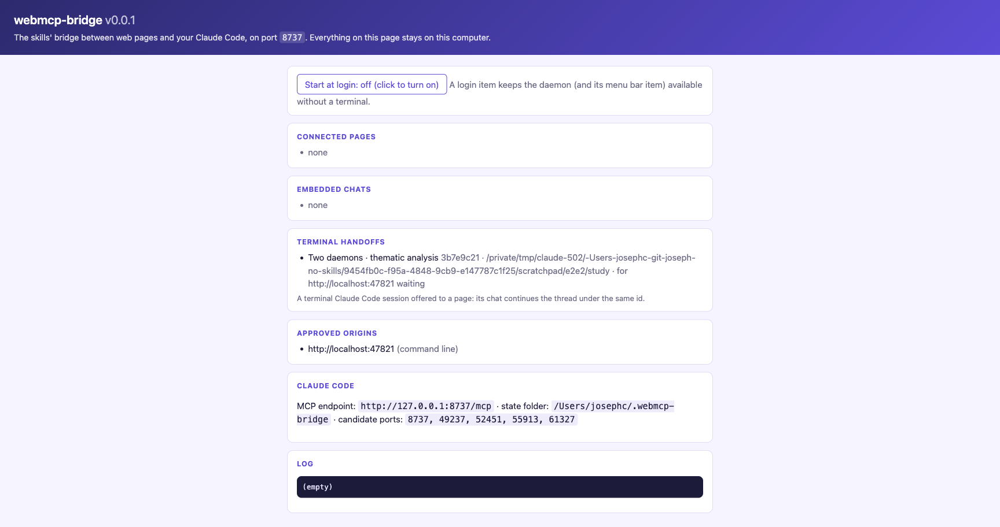

**Status:** implemented and verified 2026-11-14 (both daemons ran side by side; §5) — decisions proposed by the agent, for Joseph's review; nothing committed
**Date:** 2026-11-14
**Scope:** webmcp-bridge runs beside the upstream daemon on the same machine, at the same time, without either noticing the other: its own ports, state directory, login item, environment variables, plugin name, identity answer, menu bar glyph and status page. The upstream daemon serves science-kg; this one serves the skills in this repo.
**Inputs:** [plans/main.md](../main.md) · [Daemon port discovery](../daemon-port-discovery/main.md) (the candidate list, the single-daemon rule per state directory, `/id`) · [Terminal handoff](../terminal-handoff/main.md) · `packages/connector/src/protocol.ts`, `discover.ts` · `bridge/src/config.ts`, `instance.ts`, `launchd.ts`, `http.ts`, `security.ts`, `tray.ts`, `log.ts`, `mcp-relay.ts` · `plugin/` (manifest, hooks, scripts, command, skill) · the thematic-analysis script's daemon lookup (`scripts/ta.py`)
**Related plans:** [Project goals and plan index](../main.md)

# Two daemons on one machine: webmcp-bridge beside the upstream

> **Reading this on GitHub?** This plan is written in the interactive-plan format, a markdown dialect with tags for questions, decisions, findings and checklists. GitHub drops the tags, so the titles, statuses, severities, dates and chosen answers are missing here, and what remains reads as loose prose. Open the raw file to see them, or ask Joseph for a PDF export of the full plan.

## 0. Brief (verbatim)

Chat message, 2026-11-14:

> ok, next up, i need to be able to run both daemons at the same time, because im also going to continue developing science-kg with the original asta-bridge.
>
> So think this means at least the following things:
>
> - A different set of ports for this repo, to our client and daemon
> - different icons for the menu tray
> - Different visual for the daemon admin webpage

## 1. What the two daemons would otherwise share

The upstream and this fork are the same program with different names, so every rendezvous point collides unless it is renamed:

| Shared today | Why it matters | Here |
|---|---|---|
| Candidate ports `8717, 49217, 52431, 55893, 61307` (daemon, connector sweep, hook scripts, MCP relay) | A page or a hook finds whichever daemon took the first port; the two would steal each other's pages | `8737, 49237, 52451, 55913, 61327` |
| State directory `~/.webmcp-daemon` (the `daemon.json` lock, approvals, workspaces, handoffs, logs, the login item's copy of the bundles) | The single-daemon rule is per state directory: the second daemon refuses to start | `~/.webmcp-bridge` |
| launchd label `com.webmcp.daemon` and its plist | One login item would replace the other | `com.webmcp-bridge.daemon` |
| `WEBMCP_DAEMON_PORT`, `WEBMCP_DAEMON_STATE`, `WEBMCP_CANDIDATE_PORTS`, the tray and relay variables | One exported variable would steer both daemons | `WEBMCP_BRIDGE_*` |
| `/id` answers `daemon: "webmcp-daemon"` | Every client recognises a daemon by this name; with distinct port lists it is belt and braces, with a pinned port it is the only guard | `webmcp-bridge` |
| Plugin name `webmcp-daemon` (hooks, skill, command, MCP server namespace) | Two installed plugins with one name | `webmcp-bridge` (`/webmcp-bridge:setup`, `webmcp-bridge@webmcp-bridge`) |
| Log prefix `[webmcp-daemon …]`, the hook notice `[webmcp] …` | Two daemons' lines read the same | `[webmcp-bridge …]` |
| The menu bar item (the upstream shows its logo) | Two identical items | A generated glyph, see D-4 |
| The status page | Two identical pages on two ports | A different look, see D-5 |

Not shared, left alone: the bundle file names (`webmcp-daemon.js`, `webmcp-mcp.js`, `claude-agent-acp.js`; each plugin has its own directory and its own login-item copy), the `webmcp-connector` package name (the workbench depends on this copy by path; science-kg vendors the upstream's), the MCP server key `webmcp` inside the plugin (Claude Code namespaces it by plugin name), the wire protocol version (identity is the name, not the version).

## 2. Decisions

<decision id="D-1" title="Ports: the upstream list plus twenty" status="proposed" date="2026-11-14">
`8737, 49237, 52451, 55913, 61327`, walked in that order by the daemon, the connector, the hook scripts, the MCP relay and the thematic-analysis script. The e2e scripts' defaults and the demo page's text follow.
<rationale>Easy to remember next to the upstream's, none of them in use on this machine, the four fallbacks in the dynamic range the upstream chose for the same reason.</rationale>
</decision>

<decision id="D-2" title="Its own state directory, login item and environment variables" status="proposed" date="2026-11-14">
`~/.webmcp-bridge`; `com.webmcp-bridge.daemon`; every `WEBMCP_*` variable becomes `WEBMCP_BRIDGE_*` (`WEBMCP_BRIDGE_PORT`, `WEBMCP_BRIDGE_STATE`, `WEBMCP_BRIDGE_CANDIDATE_PORTS`, `WEBMCP_BRIDGE_TRAY`, `WEBMCP_BRIDGE_TRAY_TEXT`, `WEBMCP_BRIDGE_NO_TRAY`, `WEBMCP_BRIDGE_TRAY_ICON`, `WEBMCP_BRIDGE_TRAY_HELPER`, `WEBMCP_BRIDGE_NO_BROWSER`, `WEBMCP_BRIDGE_APPROVAL`, `WEBMCP_BRIDGE_ACP_AGENT`, `WEBMCP_BRIDGE_RELAY_*`, `WEBMCP_BRIDGE_TLS_DIR`). The variables the hook scripts set for themselves (`WEBMCP_STATE`, `WEBMCP_URL`, …) are process-local and stay.
<rationale>The state directory is what the single-daemon rule locks on, so it has to differ; the rest follows from one principle: nothing in the environment, launchd or the home directory is read by both.</rationale>
</decision>

<decision id="D-3" title="Identity and names: webmcp-bridge on /id, as the plugin, in the log" status="proposed" date="2026-11-14">
`DAEMON_NAME = 'webmcp-bridge'` (the connector's sweep, the hooks' `grep` and the daemon's own probe all check it, and since the security audit of 2026-11-14 a pinned `WEBMCP_BRIDGE_PORT` is used by the hooks only when `/id` on it answers as this daemon); the plugin is `webmcp-bridge` with `/webmcp-bridge:setup`; the `bridge` package is `webmcp-bridge`; log lines start `[webmcp-bridge …]`; the hook notices start `[webmcp-bridge]`. The `/id` protocol number stays 1. The daemon also refuses any request or upgrade whose `Host` header is not loopback (`127.0.0.1`, `localhost`, `[::1]`, with its port), which closes the DNS-rebinding gap the upstream audit had deferred.
<rationale>With separate port lists the identity check is only belt and braces, but a pinned `WEBMCP_BRIDGE_PORT` on a port the upstream happens to hold would otherwise be accepted. The plugin rename is forced: two plugins named `webmcp-daemon` cannot both be installed.</rationale>
</decision>

<decision id="D-4" title="Menu bar: a generated bridge glyph as a template image, SF Symbol fallback" status="proposed" date="2026-11-14">
`scripts/make-tray-icon.py` draws the glyph itself with Pillow (two piers, a deck and an arch, black on transparent, 72×72) into `plugin/daemon/tray/webmcp-bridge-icon.png`; the helper shows it as a template image, so the menu bar colours it. Without the file the helper falls back to the SF Symbol `app.connected.to.app.below.app`. The first menu row reads `webmcp-bridge <version>`.
<rationale>The upstream shows its company logo; a glyph drawn from nothing is unmistakably different and carries no branding at all.</rationale>
</decision>

<decision id="D-5" title="Status page: a different look, with the handoffs on it" status="proposed" date="2026-11-14">
A header band with the name and the port, a violet accent on a pale lilac page (the upstream is black on white with a green button), a **Terminal handoffs** section listing the registry with each row's live state, and the candidate ports. The approval page is titled `webmcp-bridge: approve origin` and names the bridge in its heading.
<rationale>Joseph asked for a visual the eye tells apart at once; colour and a header band do that before any word is read.</rationale>
</decision>

<decision id="D-6" title="The thematic-analysis script follows" status="proposed" date="2026-11-14">
Its daemon lookup walks the new ports, reads `~/.webmcp-bridge/daemon.json`, honours `WEBMCP_BRIDGE_PORT` and `WEBMCP_BRIDGE_STATE`, and recognises `webmcp-bridge` on `/id`; its messages name the plugin that starts the daemon.
</decision>

## 3. Checklist

<check id="k1" status="done">No file under `webmcp-bridge/` (plans excepted, as history) names the old ports, state directory, label, variables or identity; the bundles are rebuilt and `strings` agrees. — *a word-aware grep over sources, scripts, docs and figures finds nothing; the daemon and relay bundles and the tray helper carry 0 old strings and 29/3/2 new ones*</check>
<check id="k2" status="done">`bun test` and `bun run typecheck` green after the rename; the hook tests see the new notice text. — *107 pass; the one assertion that named the old notice was updated to `[webmcp-bridge] No webmcp-bridge daemon answered …`*</check>
<check id="k3" status="done">Both daemons run at once: the upstream on 8717 answering `webmcp-daemon`, this one on 8737 answering `webmcp-bridge`, each with its own state directory. — *`/id` on 8717: `{"daemon":"webmcp-daemon",…}` (Joseph's login item, untouched); on 8737: `{"daemon":"webmcp-bridge",…}` with `~/.webmcp-bridge/daemon.json`; two tray helpers in `pgrep`, one per daemon*</check>
<check id="k4" status="done">The workbench, with no `?daemon=` pin, connects to this daemon and not the upstream (the panel's daemon link points at 8737). — *first attempt went to 8717: the workbench bundle had been built before the connector was; rebuilt, the sweep found 8737, the handoff banner appeared and the panel's footer link read `http://127.0.0.1:8737/`*</check>
<check id="k5" status="done">The status page on 8737 shows the new look and the handoffs section; the menu bar helper runs with the generated glyph. — *screenshot below; `tray: showing webmcp-bridge in the menu bar` in the log with the drawn icon beside the helper*</check>
<check id="k6" status="done">`ta.py open` registers the handoff with this daemon; the script's tests pass against the new identity. — *the offer landed on 8737 (`handoff offered: session 3b7e9c21…`) and 8717's list stayed empty; pytest 112 pass*</check>

## 4. Findings

<finding id="F-1" title="A session with both plugins installed gets both hooks" severity="p3" status="open" effort="small">
Each plugin's SessionStart hook starts its own daemon and injects its own notice and page context; a page connected to one daemon is injected by that plugin only. Two notices per session is the cost of running both; the prefixes (`[webmcp]` upstream, `[webmcp-bridge]` here) tell them apart.
</finding>

## 5. Results

**Renamed in one scripted pass (45 files)** plus hand edits: the status page (`http.ts`, with `ports` on `/status.json` and a `/favicon.ico` that answers 204), the approval page heading, the tray's fallback symbol and comments, a new `scripts/make-tray-icon.py` that draws the glyph, the README's tray paragraph. The plans directory was left as history. The thematic-analysis script, its tests and the workbench's setup text follow (D-6).

**Side by side, 2026-11-14.** Joseph's upstream daemon kept running on 8717 throughout. This one started with its defaults (`node bridge/src/index.ts serve --tray`), took 8737 and `~/.webmcp-bridge`, showed its own menu bar item beside the upstream's, listed the skill's handoff while the upstream listed none, and the workbench found it by the sweep alone. It was stopped afterwards and its state directory removed; the plugin recreates it on install.

**Lesson recorded:** a page's bundle bakes in the connector it was built with, so after a connector change the page has to be rebuilt too; the workbench's first-run build order (connector, then the page) already does that for a fresh clone.

## Codex audit — 2026-11-14

Audited together with the handoff work (the record with all findings is in [terminal-handoff](../terminal-handoff/main.md)). Two findings concerned this plan:

**Changes made in response:**
- `plugin/scripts/common.sh` — a pinned `WEBMCP_BRIDGE_PORT` is honoured only when `/id` on that port answers `webmcp-bridge`; pinned at the upstream's port, the hooks now read nothing from it instead of injecting the other daemon's page state (Codex P2; test in `bridge/test/hooks.test.ts`).
- `bridge/src/http.ts` — the loopback `Host` rule (D-2/D-3 note above) means a DNS-rebinding page cannot read either daemon's `/handoffs` or `/status.json` (Codex P2).

**Deferred / not actioned:** none for this plan.

Codex's full final message saved at `/tmp/codex-audit-20261114-151118-report.md` (this run).
